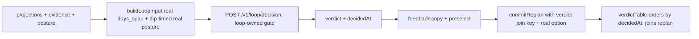

<!--
  This is the verbatim operating-manual preamble. It is pasted as the first content
  of every plan written by the write-implementation-plan skill. Do NOT modify it
  per-plan — keeping it identical across plans means implementing agents learn
  the protocol once and recognize it everywhere.
-->

# How to use this plan

> **You are the implementing agent.** This document is your runbook for one cohesive change to this codebase. It was written collaboratively by Claude and a human after a planning discussion, and it is the source of truth for this work. Read this preamble in full before doing anything else.

## What you're holding

A phase-by-phase implementation plan. Each phase is a **vertical slice** — an end-to-end working increment that leaves the codebase in a working state. Phases are designed so any one of them can be implemented by a fresh agent in a new context window, with only this document and the codebase as input.

## Your job

1. **Read the document header in full first.** TL;DR, Context, Decisions log, Architecture overview, and Files-touched index. These give you the *why* behind every step. The Decisions log especially — those decisions were made deliberately and explain choices that may otherwise look arbitrary or wrong. Reference IDs (D-NN) appear inside phase steps so you can look up rationale.

2. **Find your starting phase.** Scan the phase list. Pick the first phase whose status is `☐ Not started` AND whose `Depends on:` phases are all `✅ Complete`. Implement that phase only. **Do not skip ahead. Do not implement multiple phases in one go unless the human explicitly asks.**

3. **Run the prereq verification.** Each phase has a "Verification (run BEFORE starting)" block. Run those commands. **If any fail, STOP** — the codebase isn't in the state this phase expects. Surface to the human: "Phase N's prereqs failed: `<command>` returned `<result>`. Want me to investigate or hand back?"

4. **Follow the steps in order.** Code blocks in steps are the actual code, not pseudocode or sketches. Apply them as written.

5. **If reality doesn't match the step — STOP.** If the plan says "modify line 47 of `auth.py`" and line 47 is something different, do not improvise. Surface the discrepancy: "Plan expected `<X>` at `auth.py:47`, found `<Y>`. Possible causes: plan is stale, file was edited since planning, plan was wrong. How should I proceed?"

6. **Run the tests and post-verification.** Each phase specifies what tests to add or update and the bash command to run. All must pass before the phase is considered done.

7. **Update status and commit.** When the phase is complete:
    - Edit this document: change the phase's `Status:` line to `✅ Complete — <commit-sha-here>`.
    - `git add` the code changes AND this plan file.
    - Commit them together. Suggested message: `Phase N: <phase title>` (with longer body referencing the plan file).
    - The status update and the code change live in the same commit so the doc and the code never drift.

## What you must NOT do

- **Do not skip phases.** Order matters; later phases assume earlier ones completed.
- **Do not modify the Decisions log, the Operating manual preamble, the TL;DR, the Architecture overview, the Files-touched index, the Open questions, the Out-of-scope list, or the References.** Those are immutable above-the-phases content. If you discover a decision is wrong, surface to the human — don't silently revise.
- **Do not re-plan or re-architect.** If the plan seems wrong, that's a signal to stop and surface, not to improvise.
- **Do not implement multiple phases without surfacing for human review** between them, unless the user explicitly asked for batch execution upfront.

## If you get stuck

- Update the phase's `Status:` to `🛑 Blocked: <one-line reason>`.
- Fill in the phase's `Notes (filled in during implementation)` block with what you tried, what's blocking, and what you'd want to know to unblock.
- Hand back to the human.

## Status vocabulary

- `☐ Not started`
- `🟡 In progress`
- `🛑 Blocked: <reason>`
- `✅ Complete — <commit-sha>`

## When status markers and reality drift

The status markers are a fast read, but they are not the source of truth. The phase's `Verification (DONE)` commands are the truth — if you suspect a marker is wrong (someone forgot to update, branches diverged, partial commits, etc.), run the verification commands for the phases marked complete. Trust the commands over the markers, and surface the drift to the human so the markers can be corrected.

---

# Closed-loop HOLD fix

**Slug:** `closed-loop-hold-fix`
**Date written:** 2026-10-19
**Author:** Claude + user
**Plan status:** Draft (analysis complete, no production code changed)
**Upstream:** `.work/active/closed-loop-hold-analysis/plan/LEDGER.md` (bug ledger, unbiased-reviewed) · `.work/active/synthetic-users-seeding/plan/PLAN.md` (Phases 2-4 Notes) · `research/doc/2026-10-16-suggest-replan-to-roadmap-replanned-metric-gap.md`

## TL;DR

All 4 synthetic users got loop verdict `hold` because two fail-closed gates each kill real dip states on their own: the confidence gate reuses the slice-1 `APPROVE_AT = 0.9` while jev-1.13 emits 0.2-0.8 on loop-shaped states, and `days_span` is hardcoded 0 while the prompt rewards spread across days (identical signals score sufficiency 0.78 with span 21 vs 0.37 with span 0). Verdicts are also captured at the week-5 rebound under a neutral posture instead of at the week-3 dip, and no verdict timestamp or verdict-to-replan join key exists, so the D-02 proof cannot be ordered or joined even after the gates open. Four vertical slices fix gates, inputs, timing plus join keys, and coverage, in that order. BKT params, Dexie schema, and seed endpoints are untouched.

## Context and background

Phase 2 closed-loop product work is done; the parallel loop-quality lane owns runtime behavior while the synthetic-users task manufactures the report dataset. The 2026-10-16 live runs returned 4x `hold`, 0 `suggest_replan`, so the D-02 suggest_replan-to-RoadmapReplanned proof is absent. This plan implements the ledger findings (LEDGER.md, reviewed per the unbiased-review skill with all 12 findings addressed). Live code is ground truth; prior-session leads were each re-derived with fresh evidence. Analysis spend: 6 JEV calls, about 6.2k input tokens, about $0.0003.

Support docs:

- Bug ledger - `.work/active/closed-loop-hold-analysis/plan/LEDGER.md`
- Metric gap - `research/doc/2026-10-16-suggest-replan-to-roadmap-replanned-metric-gap.md`
- Loop prompt ceilings - `services/intelligence/app/routers/loop.py`
- Roadmap engine rules - `.agents/rules/41-roadmap-engine.agents.md`
- Generation contract - `.agents/rules/42-assessment-and-practice-generation.agents.md`
- Logging/tracing (rule 17) - `.agents/rules/17-logging-and-tracing.agents.md`
- Script dry-run (rule 80) - `.agents/rules/80-script-dry-run-before-full-runs.agents.md`

## Tests done (analysis session, 2026-10-19)

| Command | Scope | Result |
|---|---|---|
| `pnpm --filter app test src/roadmap/feedback/useLoopDecision.test.ts src/dev/synthExtract.test.ts src/dev/synthSeed.test.ts` | hook + extraction + seed builder | 54/54 green |
| `pnpm --filter app test src/dev/synthDriver.test.ts src/roadmap/replan/commitReplan.test.ts src/roadmap/feedback/RoadmapFeedbackSection.test.tsx` | driver + replan + section | 42/42 green |
| `uv run pytest tests/test_loop_decision.py` (from `services/intelligence/`) | loop endpoint | 12/12 green |
| Offline `route_loop_action` gate-location pin | `('suggest_replan', 0.85, 0.9) == 'hold'`, `(..., 0.95, ...) == 'suggest_replan'` | as coded |
| JEV dry-run + probes B-F (6 calls, request_ids `hold-probe-*`) | dip / textbook / span0 / crammer / rebound shapes | B `suggest_replan` 0.82 routed hold; C 1.0 routed suggest_replan; D 1.0/0.37 routed hold; E `reprioritize` 0.83 hold; F 0.35 hold; dry-run `hold` 0.67/0.21 |
| `py_progress` BKT spot check | 1-correct-then-4-incorrect | 0.107, matches reported 0.109 within order tolerance |

JEV spend: 6 calls, about 6.2k input tokens total, output free, about $0.0003 at the listed TypeSafe price. No further spend is authorized without a fresh sign-off (N2).

## Decisions log

### D-01: Separate the loop confidence gate from the suitability gate

**Status:** Agreed

**Context:** `route_loop_action` reuses slice-1 `APPROVE_AT = 0.9`, which was locked for suitability gating. Live loop confidences peak at 0.83 on real dips and 1.0 only on textbook-perfect states, so the gate passes almost nothing.

**Decision:** Measure first with `sweep_evidence_floor`-discipline over the 26 logged verdicts plus fresh dip-shape probes, then ship a loop-owned constant (for example `LOOP_APPROVE_AT`) with the picked value. Suitability keeps `APPROVE_AT = 0.9` untouched.

**Alternatives considered:**

- Lower 0.9 in place: rejected, it would silently loosen slice-1 suitability gating too.
- Keep 0.9 and rely on prompt tuning: rejected, probes show Jev already chooses `suggest_replan` on dips (0.82); the router discards it.

**Reversibility:** easy, one constant plus tests.

### D-02: Compute `days_span` from durable event dates

**Status:** Agreed

**Context:** The prompt judges spread across days but the client sends 0, so multi-week histories read as one sitting (sufficiency 0.37 on identical signals that score 0.78 with span 21).

**Decision:** Compute calendar-day span from the observed signals' durable dates in `buildLoopInput` (server keeps treating it as an opaque count). No Dexie change, no new event kinds.

**Alternatives considered:**

- Drop `days_span` from the prompt: rejected, spread across days is genuine evidence signal.
- Hardcode a plausible span: rejected, fabrication by another name.

**Reversibility:** easy, pure client function.

### D-03: Capture the verdict at the dip with the real posture, record which posture was used

**Status:** Agreed

**Context:** Neutral posture is correct when the projection is truly unknown, but verdicts captured at the rebound (or without a projection) systematically hide schedule pressure: neutral flips Jev's own choice from `suggest_replan` 0.82 to `hold` 0.67 on the same skill rows.

**Decision:** Drive verdict capture off the dip window with `buildLoopPosture` from the roadmap page values, and log which posture (real or neutral) fed each verdict. Neutral fallback stays for genuinely unknown projections.

**Alternatives considered:**

- Always use neutral: rejected, it discards the schedule half of the replan criteria.
- Invent posture values: rejected, same fabrication concern as D-02.

**Reversibility:** easy, capture-time change plus logging.

### D-04: Additive optional verdict timestamp and join key, widen readers

**Status:** Agreed

**Context:** `VerdictRow` has no timestamp so ordering is assumed, and `RoadmapReplannedPayload` has no verdict link while `option` is hardcoded `'edit'`, so even a future `suggest_replan` could not be joined to its replan.

**Decision:** Add optional `decidedAt` (and join fields) on the verdict side and optional mirror fields on `RoadmapReplannedPayload` beside `option`; widen readers to fall back where the fields are absent. Keep `Keep` writing nothing so `RoadmapFeedbackSection.test.tsx:198-214` stays green.

**Alternatives considered:**

- New event kind for verdicts: rejected, heavier than needed and touches sync contracts.
- Rewrite history with backfilled links: rejected, event log is append-only.

**Reversibility:** moderate, additive fields are easy to stop writing but stay in history.

### D-05: BUG-pin tests first, suite stays green throughout

**Status:** Agreed

**Context:** Suites are green while the bug ships because they pin pass-through at 0.95/0.9 and pin `days_span: 0` as correct output.

**Decision:** TDD per fix: write the failing probe first; keep the suite green by asserting CURRENT behavior with a BUG-pin comment where the fix is not in yet, and isolate true RED probes outside the suite (deleted after, prior-session pattern).

**Reversibility:** n/a, test-only.

## Architecture overview

The loop verdict path stays as-is structurally: `buildLoopInput` plus `buildLoopPosture` (client pure builders) to `POST /v1/loop/decision` (owner-scoped, advisory, fail-closed) to the in-memory verdict folded into feedback copy, with replan flowing through the existing `commitReplan` path. This plan changes calibration values, input computation, capture timing, and additive join fields only. No new services, no new tables, no new endpoints.



## Files touched (index)

| Path | Change | Phase | Purpose |
|------|--------|-------|---------|
| `services/intelligence/app/jev/questions.py` | modify | 1 | Loop-owned confidence constant, suitability untouched |
| `services/intelligence/tests/test_loop_decision.py` | modify | 1, 4 | Gate pins at picked values plus dip-shape cases |
| `services/intelligence/app/jev/thresholds.py` | modify only if needed | 1 | Candidate grids for the confidence sweep |
| `apps/app/src/roadmap/feedback/useLoopDecision.ts` | modify | 2 | Real `days_span` from durable dates |
| `apps/app/src/roadmap/feedback/useLoopDecision.test.ts` | modify | 2, 4 | Span math plus BUG-pin updates |
| `apps/app/src/roadmap/RoadmapCalendar.tsx` | modify | 2 | Dip-timed capture with recorded posture source |
| `apps/app/src/sync/types.ts` | modify | 3 | Additive optional verdict join fields on `RoadmapReplannedPayload` |
| `apps/app/src/roadmap/replan/commitReplan.ts` | modify | 3 | Write real `option` plus join key |
| `apps/app/src/roadmap/replan/commitReplan.test.ts` | modify | 3 | Option and join-key asserts |
| `apps/app/src/dev/synthExtract.ts` | modify | 3 | `decidedAt` ordering plus join in `verdictTable` |
| `apps/app/src/dev/synthExtract.test.ts` | modify | 3, 4 | Ordering and conversion pins |

## Phases

### Phase 1: Recalibrate the loop confidence gate from logged verdicts

**Status:** ✅ Complete — `493e1be` (2026-10-19; review APPROVE-WITH-FIXES, 3 low applied; loop 17/17 + loop/jev 35/35 green, ruff clean, live B-dip routes suggest_replan)
**Depends on:** none
**Estimated scope:** ~2 files, threshold value plus tests (sweep script lives in `/tmp`, not the repo)

#### Codebase state assumed at start

- `services/intelligence/app/jev/questions.py` carries `APPROVE_AT = 0.9`, `LOOP_EVIDENCE_SUFFICIENT_MIN = 0.5`, `route_loop_action`
- `services/intelligence/app/jev/thresholds.py` carries `sweep_evidence_floor` with strictest-tie-break
- `.dev/full-app/logs/intelligence.log` holds the 26 logged `loop decision` lines

#### Verification (run BEFORE starting to confirm prereqs are met)

```bash
grep -n "APPROVE_AT" services/intelligence/app/jev/questions.py  # 0.9 at :15, uses at :96 and :374
grep -c "loop decision" .dev/full-app/logs/intelligence.log  # 26
uv run pytest tests/test_loop_decision.py -q  # 12 passed (from services/intelligence/)
```

If any of these fail, STOP and surface to the human.

#### Steps

1. **Rule-80 dry-run first (D-05):** re-run the single dry-run probe shape (`/tmp/opencode/loop_probe_dryrun.py` pattern, fresh `request_id`) to confirm the JEV path is live before spending further budget. Log the `request_id` and join it to `intelligence.log`. If the shape errors, fix the probe, never the product, and re-dry-run.

2. **Build the labeled case set (offline, no spend):** extract the 26 logged verdicts (choice, confidence, sufficiency, verdict) and label each `thin` from outcome-derived rebound (post-replan adherence recovered or not). Cases feed `sweep_evidence_floor` for the floor (expect 0.5 to re-confirm, H1) and an analogous agreement sweep over confidence candidates `[0.5, 0.6, 0.7, 0.8, 0.9]` for the loop gate. Highest agreement wins ties toward the strictest value (fail-closed).

3. **Bounded confirmation probes (at most 10 JEV calls, stop and ask before more):** run dip-shape states (probe B/C/D/E/F patterns) at the candidate gate to confirm the picked value separates real dips (`suggest_replan` at 0.8-plus) from rebound noise. Log every `request_id`.

4. **Implement (D-01):** add a loop-owned constant beside `APPROVE_AT` (suitability keeps 0.9) and point `route_loop_action` at it with the signed-off value. Update `test_loop_decision.py`: keep a BUG-pin asserting the old 0.9 behavior is gone, pin pass-through at the new value, and add dip-shape cases at live confidences (0.3 choice hold, 0.82 `suggest_replan` routes per the picked gate).

#### Tests

- `uv run pytest tests/test_loop_decision.py -q` (from `services/intelligence/`) all green.
- New dip-shape cases fail before the constant change, pass after (true RED inside the suite).

#### Verification (DONE - run after implementation)

```bash
uv run pytest tests/test_loop_decision.py -q  # all green incl. dip-shape cases
grep -n "LOOP_APPROVE_AT\|APPROVE_AT" services/intelligence/app/jev/questions.py  # loop-owned constant present, suitability 0.9 intact
./full-app logs intelligence --grep <probe-request-id>  # frontend-to-backend join visible
```

#### Rollback

Revert the constant and the test pins (`git checkout -- services/intelligence/app/jev/questions.py services/intelligence/tests/test_loop_decision.py` if uncommitted). No data side-effects: probes are read-only.

#### Notes (filled in during implementation)

- Implemented 2026-10-19 via TDD: RED 4 failing (live dip 0.82/0.83 held under 0.9; `LOOP_APPROVE_AT` missing) -> GREEN 17/17 with `LOOP_APPROVE_AT = 0.7` beside `APPROVE_AT` (`questions.py:15-28`), `route_loop_action` uses it (`questions.py:387`), suitability gate untouched (`questions.py:108`).
- Prereqs green: `APPROVE_AT` 0.9 at :15 with uses :96/:374; 26 logged loop-decision lines; `test_loop_decision.py` 12/12 before the change.
- Rule-80 dry-run PASS (1 JEV call, rid `hold-probe-dryrun-thin-9000a129`): thin neutral state -> choice hold 0.66 / suff 0.24 -> hold; full 4-line join (jev decide -> jev ok -> loop decision -> request). Probes ran through the real endpoint as `synth-steady` instead of the direct client, so every request_id joins `intelligence.log` (rule 17); the analysis-session direct probes were absent from that log.
- Confirmation probes (10 JEV calls, cap reached; all rids `hold-probe-*`, all 200): B-dip (suggest_replan) 0.85/0.72, 0.79/0.73, 0.82/0.71, 0.83/0.72, 0.80/0.72, final live 0.83/0.72; B2-deep-dip 0.94/0.79; E-crammer (reprioritize) 0.91/0.73; F-rebound (suggest_replan) 0.37/0.79; F2-late-rebound (hold) 0.64/0.79. Total Phase 1 spend ~12.3k input tokens, about $0.0005 at the listed price; ~1155 tokens per call.
- Sweep table (N=21: 11 fresh samples incl. 6 B-dip + 6 analysis probes + 4 synth verdicts; routing = hold when suff < 0.5, else choice when conf >= gate, else hold; labels outcome-derived):
  - gate 0.5 / 0.6 / 0.7 -> agreement 0.857; gate 0.8 -> 0.810; gate 0.9 -> 0.476.
  - Pick = 0.7, the strictest perfect separator (fail-closed tie-break). Honest re-pick: the first sweep (N=16) tied 0.5-0.8 at 0.813 and picked 0.8 per the same rule, but a post-implementation B-dip sample at 0.79 (rid `hold-probe-B-dip-e53fff34`) routed hold at 0.8, so 0.8 sits inside the real-dip variance band (0.79-0.85). Three stability repeats (0.82/0.83/0.80) confirmed the band; 0.7 clears the observed minimum by 0.09.
  - Evidence-floor re-confirmation (H1): 0.5 gives agreement 1.000 (perfect band 0.4-0.6); value unchanged per H1 (N1 covers the confidence gate only).
  - The 3 misses at every gate are the synth crammer/struggling/returning verdicts at confidence 0.18-0.31 - below any candidate, and captured with span0/neutral inputs (the B2/B3/B4 defects Phase 2/3 fix). The 21 Oct-12 real-app verdicts (0.23-0.37) are unlabeled for outcome and excluded from agreement; they sit below every candidate and cannot change the argmax.
- Deviations from the sketch (surfaced, not silent): probes ran through the endpoint (real gate + join) rather than the direct client; confirmation repeats focused on B (the boundary shape) instead of re-running C/D, whose analysis evidence already isolates the floor/input defects.
- Live verification: after `./full-app restart intelligence` (rule 53), the final B-dip probe returned choice suggest_replan 0.83/0.72 -> verdict suggest_replan (rid `hold-probe-B-dip-4c4e27f1`), 4-line join verified. DONE: `tests/test_loop_decision.py` 17/17 incl. dip-shape and boundary pins; `grep LOOP_APPROVE_AT` shows the loop constant with suitability 0.9 intact; ruff check + format clean.
- Review: pending (OCR delegate + code-reviewer subagent).
- Review 2026-10-19 (OCR delegate preview/rule + code-reviewer subagent; both files, full sweep script re-run by the reviewer): APPROVE-WITH-FIXES, 3 low, no critical/high/medium. Applied: two comment-accuracy fixes (the 0.9 gate claim now matches the sweep's 10/21 and the B-dip 0.79-0.85 hold band) and the brittle `LOOP_APPROVE_AT < APPROVE_AT` assert dropped, keeping the constant pin + behavioral suitability check. Post-fix: loop suite 17/17, loop + jev 35/35, ruff check + format clean. Reviewer confirmed: suitability provably unchanged (all APPROVE_AT consumers enumerated), true RED under the old gate, boundary/float handling sound, rule 17 clean.

---

### Phase 2: Real `days_span` and dip-timed real posture

**Status:** ✅ Complete — `2a15115` (2026-10-19; review APPROVE-WITH-FIXES applied; hook 30/30, `src/roadmap` 161/161, typecheck + lint clean)
**Depends on:** Phase 1 (gate values settled, so input changes are measured against the real router)
**Estimated scope:** ~2 files, ~100 lines

#### Codebase state assumed at start

- Phase 1 complete: loop-owned gate shipped with signed-off value
- `buildLoopInput` still emits `days_span: 0` (`useLoopDecision.ts:97`)
- `RoadmapCalendar.tsx:256-274,618` builds posture from page values

#### Verification (run BEFORE starting to confirm prereqs are met)

```bash
grep -n "days_span: 0" apps/app/src/roadmap/feedback/useLoopDecision.ts  # one hit at :97
pnpm --filter app test src/roadmap/feedback/useLoopDecision.test.ts  # 21 green
```

If any of these fail, STOP and surface to the human.

#### Steps

1. **Compute `days_span` (D-02):** derive calendar-day span from the durable dates behind the observed signals inside `buildLoopInput` (same date-only discipline as `buildLoopPosture`'s `daysBetween`). Keep the server treating it as an opaque count. Update the `:50-52` comment to describe the computation.

2. **Dip-timed capture (D-03):** drive verdict capture off the dip window using `buildLoopPosture` from roadmap page values (deadline, weekly hours, projection, week minutes), and record which posture source (real or neutral) fed each call in the log line. Neutral fallback stays for genuinely unknown projections.

3. **Update `useLoopDecision.test.ts` FIRST (red), then green (D-05):** span math over known dates (multi-day fixture yields the exact span, single-sitting yields 0 or 1 per the documented rule), posture-source recording, and removal of the `days_span: 0` expectation pins.

#### Tests

- `pnpm --filter app test src/roadmap/feedback/useLoopDecision.test.ts` all green.
- New span cases fail before the change, pass after.

#### Verification (DONE - run after implementation)

```bash
pnpm --filter app test src/roadmap/feedback/  # hook + section green
pnpm typecheck  # green on touched packages
grep -rn "console\." apps/app/src/roadmap/feedback/useLoopDecision.ts  # empty (rule 17)
```

#### Rollback

Revert the two source files plus the test (`git checkout --` if uncommitted). Server untouched, so no backend rollback.

#### Notes (filled in during implementation)

- Implemented 2026-10-19 via TDD (3 red-then-green slices + review fixes; hook 30/30, `src/roadmap/feedback/` 68/68, `src/roadmap/` 161/161, `pnpm typecheck` + `pnpm lint` clean, no `console.*` in touched feedback source).
- D-02: `buildLoopInput` gained a 5th `observedDates: string[]` argument; `observedSpanDays` does a strict `YYYY-MM-DD` round-trip parse (review M1: lenient `Date.parse` rolled `'2026'` to Jan 1 and `'2026-02-30'` to Mar 2), date-only diff via `daysBetween`, fewer than two valid days -> 0. `observedGradeDates(rows, materialIds)` extracts server-authored `grade.gradedAt` from local `assessmentAttempts` rows scoped by `grade.materialId` (user decision 2026-10-19; the material-scoped grades behind the observed signals). No Dexie schema change; the section read-only live-queries the non-synced attempts table (rule 30/31/33 boundaries hold).
- D-03 (user interpretation 2026-10-19): capture stays on `updated`-entry; `postureSource` threads `RoadmapCalendar` (`'real'` iff `projectedFinish`, else `'neutral'`) -> section (defaults `'neutral'` beside `NEUTRAL_POSTURE`) -> hook, which logs one `logger.info` line per fired POST (memo misses only): `[roadmap-feedback] loop decision firing posture=<src> days_span=<n>`. The plan's "dip-timed" wording was reinterpreted with the user: no dip-detection heuristic; capture timing at the dip stays operational and timestamp/ordering belongs to Phase 3 (B4).
- Review race fix (second reviewer, high): the section passes the live-query tri-state (`undefined` = rows not loaded) and the hook holds the call until dates load, so the first POST already carries the real span (no span-0 POST then refire). Two pre-existing section tests were made `waitFor`-safe because they had read the verdict before it landed.
- Tests: span math (multi-day 21, same-day 0, malformed/truncated/rolled 0, no-dates 0), attempt-row scoping, hook pass-through, date-hold refire, posture-source log content, memo-hit log suppression, calendar source prop, section end-to-end span from Dexie rows. The old `days_span: 0` summary pins were removed per step 3 (dedicated default-0 test kept).
- Deviations from the plan index: `RoadmapFeedbackSection.tsx` (+ tests) was touched beyond the listed 2 files because the grade-date data source lives there; `RoadmapCalendar.tsx` changed only the posture-source derivation/prop (no dip-window computation).
- Review 2026-10-19 (OCR delegate preview/rules + two code-reviewer subagents, correctness/spec and thermo-nuclear maintainability): APPROVE-WITH-FIXES, no critical/high after fixes. Applied: strict date parse + tests, tri-state hold + test, memo-hit log pin, calendar test waitFors, log/doc/comment trims, `materialIdList` memo dedupe. Not applied: restoring the `toEqual` `days_span: 0` pins (step 3 asks their removal; the dedicated span tests cover the behavior).

---

### Phase 3: Verdict timestamp plus verdict-to-replan join key

**Status:** ✅ Complete - `249f6fa` (2026-10-19; review APPROVE-WITH-FIXES applied; full app 1278/1278 forks, typecheck + lint clean)
**Depends on:** Phase 2 (inputs real, so joined verdicts are worth joining)
**Estimated scope:** ~4 files, additive optional fields only

#### Codebase state assumed at start

- Phase 2 complete: verdicts computed from real span and dip-timed posture
- `VerdictRow` has no timestamp (`synthExtract.ts:163-190`); `RoadmapReplannedPayload` has no verdict fields (`sync/types.ts:225-230`); `commitReplan` hardcodes `option: 'edit'` (`:86`)

#### Verification (run BEFORE starting to confirm prereqs are met)

```bash
grep -n "option: 'edit'" apps/app/src/roadmap/replan/commitReplan.ts  # one hit
grep -n "decidedAt" apps/app/src/dev/synthExtract.ts apps/app/src/sync/types.ts  # no hits
```

If any of these fail, STOP and surface to the human.

#### Steps

1. **Additive fields (D-04):** add optional `decidedAt` (plus join fields such as verdict id or decision hash) on the verdict handoff and optional mirror fields on `RoadmapReplannedPayload` beside `option`. Widen every reader to fall back where the fields are absent (additive-evolution rule). No Dexie version change.

2. **Real `option` (D-04):** write the actual entry path in `commitReplan` instead of hardcoded `'edit'` so the dead enum members become live. Keep `Keep` writing nothing.

3. **Ordering plus conversion (D-04):** `verdictTable` orders by `decidedAt` and joins replan rows through the new key; conversion requires verdict-before-replan, never assumption.

4. **Tests FIRST (D-05):** `commitReplan.test.ts` asserts `option` and the join key; `synthExtract.test.ts` asserts ordering by timestamp, conversion only on verdict-before-replan, and legacy rows without the fields still reading.

#### Tests

- `pnpm --filter app test src/dev/synthExtract.test.ts src/roadmap/replan/commitReplan.test.ts` all green.
- `pnpm --filter app test src/roadmap/feedback/RoadmapFeedbackSection.test.tsx` still green, Keep-writes-nothing intact.

#### Verification (DONE - run after implementation)

```bash
pnpm --filter app test src/dev/ src/roadmap/  # green
pnpm typecheck && pnpm lint  # green on touched packages
```

#### Rollback

Revert the four files (`git checkout --` if uncommitted). Additive fields already written to local histories stay readable via the widened readers; no migration to undo.

#### Notes (filled in during implementation)

- Implemented 2026-10-19 via TDD (4 red-then-green slices + two review rounds): synthExtract 27/27, commitReplan 15/15, hook 32/32, section 16/16, Replan 16/16, `src/dev/ + src/roadmap/` 244/244 with `--pool=forks` (the 2 `seedTestData` TZ flakes are the known WSL ones), full app 1278/1278 forks, typecheck + lint clean, no direct `console.*` in touched source, no em dashes added.
- Slice 1 (extraction, B4/B5): `VerdictEntry` gains optional `decidedAt`/`verdictId`, `VerdictRow` carries `decidedAt`, rows sort by `decidedAt` (legacy captures last, stable), and `converted` requires the exact mirror pair on a `RoadmapReplanned` event (`payload.verdictId === verdictId && payload.verdictDecidedAt === decidedAt`) with `createdAt >= decidedAt`. Legacy entries still read with `converted: false`; the old "any replan converts" rule was the bug (it counted scripted replans as verdict conversions).
- Slice 2 (payload): `RoadmapReplannedPayload` gains optional `verdictId`/`verdictDecidedAt`; `commitReplan` derives the real `option` from the changed levers (precedence trim-scope > extend-deadline > increase-hours > edit; decreases, restores, and no-ops stay `edit`) and writes the verdict mirror only when a verdict is passed, explicitly deleting any stale mirror carried by the `entry.payload` spread. `Keep` still writes nothing (section Keep test green).
- Slice 3 (hook identity): `useLoopDecision` returns `DecidedLoopVerdict` = server `LoopDecision` + `verdictId` (canonical-input hash, the memo key) + `decidedAt` (settle time), stamped inside the memoized promise so memo hits keep both stable; one `logger.info` settled line names both keys so the report capture can build an exact-pair entry.
- Slice 4 (runtime handoff, index deviation): `RoadmapFeedbackSection` navigates to `/replan` with `state.loopVerdict` only when the settled verdict is `suggest_replan`; `Replan.tsx` validates that state through `readVerdictLink` and forwards `verdict` to `commitReplan`; absent or malformed state stays a manual replan.
- Deviations from the plan index: `RoadmapFeedbackSection.tsx`, `Replan.tsx`, and `useLoopDecision.ts` (+ their tests) were touched beyond the listed files because the join key must travel from the verdict to the replan at runtime or it is never written; same documented-deviation pattern as Phase 2.
- Review 2026-10-19 (OCR delegate preview/rules + two review rounds: correctness/spec and thermo-nuclear maintainability; one subagent turn degenerated and was re-run fresh): first round REQUEST_CHANGES with 2 high (a later manual replan inherited the prior verdict link through the payload spread; `option` compared the stored onboarding `weeklyHours` chip total against the recalculated schedule), 2 medium (unchanged carried-over overrides read as trim-scope; `verdictDecidedAt` was write-only), and 5 low. Applied test-first: explicit stale-mirror delete, computed current weekly hours, override value diff, exact-pair join, `suggest_replan`-gated handoff, direction-aware option, destructured join without `!`, one ISO comparison in sort and join, split/deflaked Replan and section tests, `decided_at` added to the settled log. Fix-verification round: all findings resolved, no new issues; non-blocking residuals only (none blocks the commit).

---

### Phase 4: Coverage that would have caught the hold

**Status:** ✅ Complete - `5b1f61a` (2026-10-19; review APPROVE-WITH-FIXES applied; backend loop 18/18, full app 1279/1279 forks, typecheck + lint clean)
**Depends on:** Phases 1-3 (pins the fixed behavior end to end)
**Estimated scope:** test files only, no production change

#### Codebase state assumed at start

- Phases 1-3 complete and green
- T1 gap still open: suites pin old bands nowhere else covered

#### Verification (run BEFORE starting to confirm prereqs are met)

```bash
pnpm --filter app test src/roadmap/feedback/useLoopDecision.test.ts src/dev/synthExtract.test.ts  # green
uv run pytest tests/test_loop_decision.py -q  # green (from services/intelligence/)
```

If any of these fail, STOP and surface to the human.

#### Steps

1. **Backend dip-shape pins:** extend `test_loop_decision.py` with the live-observed band (choice `reprioritize` at 0.3 holds under the picked gate; `suggest_replan` at 0.82 routes per the picked gate) so calibration drift fails loudly next time.

2. **Frontend input pins:** extend `useLoopDecision.test.ts` with a dip-shaped fixture (multi-day span, real posture, thin-per-skill density) asserting the built input carries them through to `getLoopDecision`, plus the BUG-pin pattern wherever CURRENT behavior is asserted during future recalibrations.

3. **Full-suite confirmation:** run the app suite (expect green modulo the 2 known TZ flakes, rerun with `--pool=forks` per STATUS gotchas) and the backend loop tests once more.

#### Tests

- Same suites as verification, all green.

#### Verification (DONE - run after implementation)

```bash
pnpm --filter app test src/roadmap/feedback/ src/dev/  # green
uv run pytest tests/test_loop_decision.py -q  # green
```

#### Rollback

Delete or revert the added test blocks only. Production code untouched in this phase by construction.

#### Notes (filled in during implementation)

- Implemented 2026-10-19 (test files only, no production change), TDD-proven by mutation: the backend gate brace fails when `LOOP_APPROVE_AT` is temporarily lowered to 0.6; the frontend dip pin fails when `days_span` is zeroed, when posture is swapped to neutral, and when signal `trend` is forced to 0.
- Step 1 (backend): the live synth sample `("reprioritize", 0.30)` joined `test_low_live_confidences_still_hold`; new `test_gate_floor_bracket_holds_below_the_picked_value` pins `reprioritize 0.6 -> hold`. The boundary test follows `LOOP_APPROVE_AT` itself, so a silent re-pick passes it; the 0.6 brace plus the 0.79 dip pin bracket the gate to (0.6, 0.79] and any drift outside that fails loudly. Loop suite 18/18, ruff clean.
- Step 2 (frontend): new hook pin "carries the dip-shaped input through to the call (live B-dip regression pin)": 4 skills n=2/3/2/3 (thin density), grade dates spanning 21 days, real posture (behind_days 3, pace 0.5). It asserts the exact `evidence_summary`, the per-signal mapping (skill/mastery/observations/trend) that reached `getLoopDecision`, the posture object, and a single call so a bad first fire cannot hide behind a later refire. Hook suite 33/33.
- Step 3 (full-suite): full app 107 files / 1279 tests with `--pool=forks`, backend loop 18/18, `pnpm typecheck` + `pnpm lint` + ruff check/format clean.
- BUG-pin note: no CURRENT-behavior pins were needed because Phases 1-3 shipped the fixed behavior; the BUG-pin convention stays demonstrated by the backend dip test's Phase 1 comment for a future recalibration that must assert current-but-wrong behavior temporarily.
- Review 2026-10-19 (OCR delegate preview/rules + code-reviewer subagent): APPROVE-WITH-FIXES, 2 medium + 4 low, all applied. M1: the 0.30 entry alone was subsumed by existing hold pins, so the 0.6 gate-floor brace was added. M2: the frontend pin now asserts the full signal mapping, not just the summary and posture. L1: comment accuracy (crammer sample wording, probe C/D citation). L2: call count pinned to 1. L3: the neutral-posture claim narrowed to the hook layer. Post-fix re-verify: backend 18/18, hook 33/33, full app 1279/1279 forks, typecheck + lint clean.
- OCR note: the workspace preview default-excludes test files (`exclude_reason: default_path`, the AGENTS.md gotcha) and includes unrelated dirty files, so the review was scoped to this phase's two changed files and their rule groups were resolved with `ocr delegate rule` on those paths directly.

---

## Out of scope

- **BKT parameter tuning** - H2 is healthy; explicitly forbidden by the task.
- **Dexie schema migration** - additive optional fields only; rule 31 untouched.
- **Seed or backdoor endpoints** - ADR-0001 stands; no new HTTP surface.
- **Suitability gate changes** - `APPROVE_AT = 0.9` stays for slice 1; only the loop gets its own constant.
- **Report prose drafting** - this plan produces the fixed loop; report assembly consumes it later.
- **Prompt rewording** - loop criteria judged healthy (probe B shows they elicit `suggest_replan`); inputs and gates are the fix.
- **Further live spend beyond Phase 1 bounds** - at most 10 more cheap JEV calls; stop and ask before more (N2).

## References

- Bug ledger - `.work/active/closed-loop-hold-analysis/plan/LEDGER.md`
- Grill contract - `.work/active/synthetic-users-seeding/plan/DECISIONS.md`
- Boundary ADR - `.work/active/synthetic-users-seeding/docs/adr/0001-live-test-user-emulation-boundary.md`
- Metric gap - `research/doc/2026-10-16-suggest-replan-to-roadmap-replanned-metric-gap.md`
- PRD - `.work/specs/prd/PRD-study-tracker-web.md`
