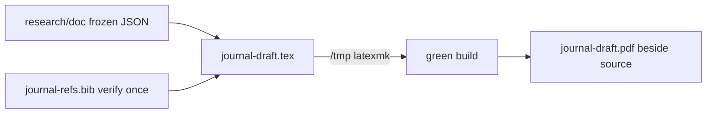

<!--
  This is the verbatim operating-manual preamble. It is pasted as the first content
  of every plan written by the write-implementation-plan skill. Do NOT modify it
  per-plan — keeping it identical across plans means implementing agents learn
  the protocol once and recognize it everywhere.
-->

# How to use this plan

> **You are the implementing agent.** This document is your runbook for one cohesive change to this codebase. It was written collaboratively by Claude and a human after a planning discussion, and it is the source of truth for this work. Read this preamble in full before doing anything else.

## What you're holding

A phase-by-phase implementation plan. Each phase is a **vertical slice** — an end-to-end working increment that leaves the codebase in a working state. Phases are designed so any one of them can be implemented by a fresh agent in a new context window, with only this document and the codebase as input.

## Your job

1. **Read the document header in full first.** TL;DR, Context, Decisions log, Architecture overview, and Files-touched index. These give you the *why* behind every step. The Decisions log especially — those decisions were made deliberately and explain choices that may otherwise look arbitrary or wrong. Reference IDs (D-NN) appear inside phase steps so you can look up rationale.

2. **Find your starting phase.** Scan the phase list. Pick the first phase whose status is `☐ Not started` AND whose `Depends on:` phases are all `✅ Complete`. Implement that phase only. **Do not skip ahead. Do not implement multiple phases in one go unless the human explicitly asks.**

3. **Run the prereq verification.** Each phase has a "Verification (run BEFORE starting)" block. Run those commands. **If any fail, STOP** — the codebase isn't in the state this phase expects. Surface to the human: "Phase N's prereqs failed: `<command>` returned `<result>`. Want me to investigate or hand back?"

4. **Follow the steps in order.** Code blocks in steps are the actual code, not pseudocode or sketches. Apply them as written.

5. **If reality doesn't match the step — STOP.** If the plan says "modify line 47 of `auth.py`" and line 47 is something different, do not improvise. Surface the discrepancy: "Plan expected `<X>` at `auth.py:47`, found `<Y>`. Possible causes: plan is stale, file was edited since planning, plan was wrong. How should I proceed?"

6. **Run the tests and post-verification.** Each phase specifies what tests to add or update and the bash command to run. All must pass before the phase is considered done.

7. **Update status and commit.** When the phase is complete:
   - Edit this document: change the phase's `Status:` line to `✅ Complete — <commit-sha-here>`.
   - `git add` the code changes AND this plan file.
   - Commit them together. Suggested message: `Phase N: <phase title>` (with longer body referencing the plan file).
   - The status update and the code change live in the same commit so the doc and the code never drift.

## What you must NOT do

- **Do not skip phases.** Order matters; later phases assume earlier ones completed.
- **Do not modify the Decisions log, the Operating manual preamble, the TL;DR, the Architecture overview, the Files-touched index, the Open questions, the Out-of-scope list, or the References.** Those are immutable above-the-phases content. If you discover a decision is wrong, surface to the human — don't silently revise.
- **Do not re-plan or re-architect.** If the plan seems wrong, that's a signal to stop and surface, not to improvise.
- **Do not implement multiple phases without surfacing for human review** between them, unless the user explicitly asked for batch execution upfront.

## If you get stuck

- Update the phase's `Status:` to `🛑 Blocked: <one-line reason>`.
- Fill in the phase's `Notes (filled in during implementation)` block with what you tried, what's blocking, and what you'd want to know to unblock.
- Hand back to the human.

## Status vocabulary

- `☐ Not started`
- `🟡 In progress`
- `🛑 Blocked: <reason>`
- `✅ Complete — <commit-sha>`

## When status markers and reality drift

The status markers are a fast read, but they are not the source of truth. The phase's `Verification (DONE)` commands are the truth — if you suspect a marker is wrong (someone forgot to update, branches diverged, partial commits, etc.), run the verification commands for the phases marked complete. Trust the commands over the markers, and surface the drift to the human so the markers can be corrected.

---

# Phase-2 journal final stage

**Slug:** `journal-final-stage`
**Date written:** 2026-10-23
**Author:** Claude + Rohit
**Plan status:** Draft
**Upstream:** `.work/active/phase2-journal/state.md` · grill session 2026-10-23 (9 locked decisions) · `college/mydeliverables/phase2-journal/`

## TL;DR

The v0 draft (`journal-draft.tex`, 7pp green) becomes a submittable 11pp Springer manuscript under the held `sn-mathphys,Numbered` single-column class. Five phases in strict order: verify the bibliography and delete one rendered publisher instruction; add three pgfplots data figures (retrieval + DDIA, BKT, verdict + dip) beside the existing 3 TikZ schematics; finish back matter with a per-table evidence appendix; grow prose to 11pp using only frozen evidence; then run the triple prose gate (STE, humanizer, ai-writing-pattern-audit) and refresh the beside-source PDF. Every phase ends in a green `/tmp` build with zero errors, zero warnings, and zero undefined references. No new live runs, no new measurements, no screenshots.

## Context & background

The `phase2-journal` task closed all 9 live evidence gaps on 2026-10-22 (endpoint 0.70/0.90/0.813 reranked, DDIA deltas +16/+17, live harness coding 0.5349, 4/4 dip holds + rebound gradient, book ready ~88 s; evidence in `research/doc/2026-10-22-*`). The v0 draft compiled green at 7pp with abstract 184 words, 4 coherent tables, and 3 single-column TikZ schematics. The 2026-10-23 grill locked 9 decisions (see log): hold the default class, grow to the 11pp house model (Sample1/Sample2) by writing only, verify bibliography before prose, add data plots, delete editorial residue, Not-applicable ethics with an evidence-mapped appendix, `/tmp`-only builds with a green bar, a three-tool prose gate with the audit last, and advisor sign-off as a separate downstream gate.

Standing constraints: rule 60 (build LaTeX in `/tmp` only, never commit aux/log noise, refresh the beside-source review PDF from green builds only); single `.tex` file, no `\input`; never mix IEEE formatting into this Springer work; never invent numbers — every value traces to frozen evidence or live code; never write secrets into `.work/` or sources.

**Support docs:**

- Draft sources: `college/mydeliverables/phase2-journal/journal-draft.tex` (402 lines), `journal-refs.bib` (24 keys)
- Evidence brief: `.work/active/phase2-journal/research/journal-content-brief.md`
- Template rules: `.work/active/phase2-journal/research/sn-template-structure.md`
- House model: `.work/active/phase2-journal/research/springer-sample-pattern.md`
- Prose authorities: `.work/specs/phase2-prose-review-ste-humanizer.md`, `.agents/skills/ste-writing/SKILL.md`, `.agents/skills/humanizer/SKILL.md`, `.agents/skills/ai-writing-pattern-audit/SKILL.md`
- Task record: `.work/active/phase2-journal/state.md`, `.work/active/phase2-journal/SCRATCHPAD.md`

## Decisions log

### D-01: Hold sn-mathphys,Numbered single-column

**Status:** ✅ Agreed

**Context:** Target journal and reference style were unconfirmed; every downstream choice (column layout, bst style, ethics boilerplate, page target) pivots on this.

**Decision:** Hold `\documentclass[sn-mathphys,Numbered]{sn-jnl}` single-column unless the advisor names a journal.

**Rationale:** Both house samples render single-column numbered, consistent with this class line; switching later is one line plus a bst swap.

**Alternatives considered:**

- `iicol` double column → rejected: needs `table*`/`figure*` rework for zero committed benefit.
- Wait for advisor pick before any work → rejected: blocks all writing on someone else's calendar.

**User pushback / disagreement:** none — user replied "hold sn-mathphys,Numbered".

**Reversibility:** easy — one class option plus `bst/` swap.

### D-02: Grow 7pp to 11pp by writing only

**Status:** ✅ Agreed

**Context:** Draft is 7pp green; the Sample1/Sample2 house model is 11pp and `state.md` prescribed growth to 11pp.

**Decision:** Target 11pp; the ~4pp growth goes to Lit Review depth, Results/Discussion, and the evidence appendix. No new experiments.

**Rationale:** All 9 live gaps are closed with frozen evidence, so growth is pure writing at zero run cost; stopping at 7pp under-reports the brief's numbers table against the advisor-accepted 11pp model.

**Alternatives considered:**

- Stop at tight 7-8pp → rejected: leaves grounded numbers unreported.
- New measurements to fill pages → rejected: gaps are closed; new runs spend budget for no locked reason.

**User pushback / disagreement:** none — user replied "yeah".

**Reversibility:** easy — page target is an editing dial, not a structural commitment.

### D-03: Bibliography verify pass before prose

**Status:** ✅ Agreed

**Context:** `journal-refs.bib` header flags its own verify pass as open: title-only `misc` entries with no author claim, `Chen and others` placeholders, missing page ranges, unverified Qwen3 model-card details.

**Decision:** Full verify pass first (full author lists, page ranges, model-card facts checked against sources), prose second.

**Rationale:** Placeholder authors in numbered references are a desk-reject-class defect visible in minutes; prose polish is invisible until cites are correct; verify facts come from already-cited sources with no new runs.

**Alternatives considered:**

- Prose first, cites later → rejected: citation-adjacent wording changes anyway after verify.
- Ship placeholders → rejected: desk-reject risk.

**User pushback / disagreement:** none — user replied "ok".

**Reversibility:** easy — bib edits are text.

### D-04: Three data plots join the 3 TikZ schematics

**Status:** ✅ Agreed

**Context:** Draft has 3 TikZ schematics and zero data plots; the brief's shopping list named grading bars, a mastery AUC figure, and an adherence figure. User pushed back on a tables-only lock: "What data plots can we bring, itll be nice to have".

**Decision:** Lock figures at 3 TikZ + 3 data plots: (1) retrieval grouped bars with DDIA small-multiple, (2) BKT AUC/ECE panel, (3) verdict sufficiency bars combined with the dip-window trajectory. Timing stack and endpoint bars stay tables/appendix. Adherence is appendix-at-most with its rebound-era caveat in the caption.

**Rationale:** The three plots carry the three claims the conclusion restates (reranked retrieval, BKT parity, gated replans); endpoint and timing numbers already live in tables; more plots would spend the 4pp growth on ink instead of Lit depth.

**Alternatives considered:**

- Tables only, no plots → rejected by user pushback.
- Plot everything incl. adherence in main body → rejected: next-week 0.000 needs a full caveat paragraph to avoid reading as failure.
- Screenshots → rejected: bloat page budget and invite re-measurement disputes.

**User pushback / disagreement:** User asked what data plots were possible, then accepted the three-plot set ("ok").

**Reversibility:** moderate — figure code is deletable, but in-text pointers must go with it.

### D-05: pgfplots inline for data plots

**Status:** 🤔 Assumed (unconfirmed)

**Context:** Data plots need a toolchain; the draft already loads TikZ, and the Springer header comment requires a single `.tex` file.

**Decision:** Draw data plots with `pgfplots` inline in `journal-draft.tex` (plus `\usepackage{pgfplots}` and `\pgfplotsset{compat=1.18}` in the preamble). No matplotlib, no external figure files.

**Rationale:** Inline pgfplots keeps the single-`.tex` submission rule intact with zero extra attached files, matches the existing TikZ figures stylistically, and plots exact frozen values with no rendering pipeline to re-run.

**Alternatives considered:**

- matplotlib PDFs attached separately → rejected: extra files plus a Python figure pipeline the repo does not need.
- Hand-drawn TikZ bars without pgfplots → rejected: axis/scale errors by hand; pgfplots computes bar placement.

**User pushback / disagreement:** none — never explicitly confirmed; toolchain was not grilled.

**Reversibility:** moderate — swapping to external PDFs means new files plus `\includegraphics` edits.

### D-06: Delete the rendered editorial instruction

**Status:** ✅ Agreed

**Context:** User added: "also have to fix `Editorial notes left in the manuscript`". A repo-wide grep for TODO/placeholder/sample-text residue found exactly one rendered instance.

**Decision:** Delete `journal-draft.tex:389-390` (`\noindent` + the "If a section does not apply to your manuscript…" publisher instruction) as a fix-before-submission item in Phase 1.

**Rationale:** It is rendered body text, not a `%` comment — it prints in the PDF. The grep proved no other residue of that class exists.

**Alternatives considered:**

- Leave it as harmless boilerplate → rejected: it is an instruction to the author, visible to reviewers.

**User pushback / disagreement:** none — user raised it themselves ("ok" to folding it into the exit list).

**Reversibility:** trivial — one paragraph.

### D-07: Back matter shape

**Status:** ✅ Agreed

**Context:** Draft carries the 8-bullet Declarations shell (mostly Not applicable), Acknowledgments, a Supplementary paragraph, and an Appendix A evidence-index stub.

**Decision:** Keep ethics/consent as Not applicable (synthetics only, no live-user dataset — the template's ethics enumerate does not trigger). Name the supplementary set as the 8 frozen evidence files. Expand Appendix A into a per-table evidence map.

**Rationale:** A per-table evidence map makes every headline number checkable, which is the paper's stated honesty contract.

**Alternatives considered:**

- Full ethics boilerplate → rejected: no human/animal data reported.
- Thin appendix stub → rejected: checkability is the paper's core claim.

**User pushback / disagreement:** none — user replied "ok".

**Reversibility:** easy — back matter text.

### D-08: Green-build bar from the first figure pass

**Status:** ✅ Agreed

**Context:** The checked-in `journal-draft.log` shows a stale in-source build failure (`sn-jnl.cls not found` — built in-source instead of `/tmp` per rule 60). Page counts cannot be trusted on a broken layout.

**Decision:** Every phase rebuilds in `/tmp` only, refreshes the beside-source `journal-draft.pdf` from each green build, commits no aux/log noise, and holds 0 errors / 0 warnings / 0 undefined refs with abstract 180-200 words before the prose gate starts.

**Rationale:** Stacking prose edits on a broken layout creates rework; the bar enforced early keeps the 11pp count honest.

**Alternatives considered:**

- Build in-source for speed → rejected: rule 60 plus the stale-log precedent.
- Relax warnings → rejected: warnings hide undefined refs and overfull boxes that move pagination.

**User pushback / disagreement:** none — user replied "ok".

**Reversibility:** N/A — process discipline.

### D-09: Prose gate order — STE, humanizer, ai-audit last

**Status:** ✅ Agreed

**Context:** `phase2-prose-review` Ch01 precedent came back STE FAIL with fix spans; user added `.agents/skills/ai-writing-pattern-audit` to the review. The audit skill's document-level checks (abstract↔methods↔results↔conclusion consistency, claim-evidence alignment, template residue) need frozen cites and figures.

**Decision:** Run all three post-reflow in order: STE lint, then humanizer, then ai-writing-pattern-audit. Resolve every fix span.

**Rationale:** Same-voice chapters already failed STE once; fixing sentences before figures land creates reflow rework; the audit's consistency checks are meaningless on moving text.

**Alternatives considered:**

- Audit first → rejected: burns a pass on text reflow will move.
- STE only, skip the other two → rejected: user explicitly added the audit; humanizer covers the AI-tell patterns STE does not.

**User pushback / disagreement:** none — user replied "ok" then "Sure" to the audit addition.

**Reversibility:** N/A — review process.

## Architecture overview

Two files change, one artifact refreshes. `journal-draft.tex` absorbs all content work in dependency order (residue deletion → figure code + pointers → back matter → prose growth → prose fixes). `journal-refs.bib` is verified once in Phase 1 and then frozen — later phases never touch it, so citation keys stay stable while prose moves. `journal-draft.pdf` beside the source is refreshed from every green `/tmp` build per the standing rule. Evidence JSONs under `research/doc/` are read-only inputs; the plan never writes outside `college/mydeliverables/phase2-journal/` and `.work/active/phase2-journal/`.



## Files touched (index)

| Path | Change | Phase | Purpose |
|------|--------|-------|---------|
| `college/mydeliverables/phase2-journal/journal-refs.bib` | modify | 1 | Full authors, page ranges, model-card facts; then frozen |
| `college/mydeliverables/phase2-journal/journal-draft.tex` | modify | 1 | Delete lines 389-390 editorial instruction |
| `college/mydeliverables/phase2-journal/journal-draft.tex` | modify | 2 | pgfplots preamble + retrieval/DDIA figure + in-text pointer |
| `college/mydeliverables/phase2-journal/journal-draft.tex` | modify | 3 | BKT panel + verdict/dip figure + Appendix A map + supplementary paragraph |
| `college/mydeliverables/phase2-journal/journal-draft.tex` | modify | 4 | 11pp prose growth (Lit depth + Results discussion) |
| `college/mydeliverables/phase2-journal/journal-draft.tex` | modify | 5 | Prose-gate fixes (STE + humanizer + ai-audit spans) |
| `college/mydeliverables/phase2-journal/journal-draft.pdf` | modify | 1-5 | Refreshed from each green build (standing rule) |
| `.work/active/phase2-journal/plan/2026-10-23-journal-final-stage.md` | new | 0 | This plan (status updates per phase) |

## Phases

### Phase 1: Verify bibliography and delete editorial residue

**Status:** ✅ Complete — b8a4e66
**Depends on:** none — can start immediately
**Estimated scope:** ~2 files, ~40 lines

#### Codebase state assumed at start

- `college/mydeliverables/phase2-journal/journal-draft.tex` is the 402-line v0 shell with the publisher instruction at lines 389-390.
- `college/mydeliverables/phase2-journal/journal-refs.bib` holds 24 keys with `and others` placeholders and title-only `misc` entries.
- `sn-jnl.cls` sits at `college/mydeliverables/phase2-journal/sn-article-template/sn-jnl.cls`; `sn-mathphys.bst` at `.../sn-article-template/bst/sn-mathphys.bst`.
- TinyTeX is installed (`$HOME/.TinyTeX` or `$HOME/Library/TinyTeX`); `pgfplots` not yet needed.

#### Verification (run BEFORE starting to confirm prereqs are met)

```bash
ls college/mydeliverables/phase2-journal/journal-draft.tex college/mydeliverables/phase2-journal/journal-refs.bib college/mydeliverables/phase2-journal/sn-article-template/sn-jnl.cls college/mydeliverables/phase2-journal/sn-article-template/bst/sn-mathphys.bst  # all four exist
grep -n "does not apply to your manuscript" college/mydeliverables/phase2-journal/journal-draft.tex  # line 390
grep -c "and others" college/mydeliverables/phase2-journal/journal-refs.bib  # nonzero (placeholders present)
ls -d "$HOME"/.TinyTeX/bin/* 2>/dev/null || ls -d "$HOME"/Library/TinyTeX/bin/* 2>/dev/null  # TinyTeX present
```

If any of these fail, STOP — the checkout isn't in the expected state. Surface to the human.

#### Steps

1. **Verify `journal-refs.bib` key by key (implements D-03).** Use web search against publisher pages / DOIs already in the file. Requirements for DONE:
   - No `and others` remains; every `author` field carries the full author list.
   - `zanellati2024` and `alhazbi2024` gain page ranges; every entry gains `volume`/`number`/`pages` where the venue publishes them.
   - `qwen3emb` / `qwen3rerank` facts checked against the Qwen model cards; correct any wrong year/venue detail in `howpublished`/`note`.
   - Tool `misc` entries (`piston`, `openrouter`) keep corporate-authorship form but each carries an explicit `author` or `organization` plus year — no anonymous entries.
   - The two `@comment` verify-pass headers are deleted once their items are done; if a single fact proves unverifiable, keep one narrow `@comment` naming exactly that fact (do not keep the blanket headers).
   - Never invent an author name, page range, or DOI. Unverifiable after a genuine search stays a flagged `@comment`, not a guess.

2. **Delete the editorial instruction in `journal-draft.tex` (implements D-06).** Exact deletion — `oldString` is the trailing `\noindent` plus instruction paragraph:

   ```latex
   \noindent
   If a section does not apply to your manuscript, include its heading and write `Not applicable'.

   \begin{appendices}
   ```

   becomes:

   ```latex
   \begin{appendices}
   ```

3. **Green rebuild in `/tmp` only (implements D-08).** Copy exactly these four inputs (class + style beside the sources, as the class requires) and build:

   ```bash
   rm -rf /tmp/journal-final && mkdir -p /tmp/journal-final
   cp college/mydeliverables/phase2-journal/journal-draft.tex college/mydeliverables/phase2-journal/journal-refs.bib college/mydeliverables/phase2-journal/sn-article-template/sn-jnl.cls college/mydeliverables/phase2-journal/sn-article-template/bst/sn-mathphys.bst /tmp/journal-final/
   TEXBIN="$(ls -d "$HOME"/.TinyTeX/bin/* 2>/dev/null || ls -d "$HOME"/Library/TinyTeX/bin/* 2>/dev/null)"
   env PATH="$TEXBIN:$PATH" latexmk -pdf -interaction=nonstopmode -halt-on-error journal-draft.tex  # run with cwd /tmp/journal-final (bash workdir param)
   ```

   Then refresh the beside-source PDF from that green build only:

   ```bash
   cp /tmp/journal-final/journal-draft.pdf college/mydeliverables/phase2-journal/journal-draft.pdf
   ```

   Never copy `.aux`, `.log`, `.fls`, `.fdb_latexmk`, `.bbl`, or `.blg` back into the repo.

#### Tests

- No code tests (LaTeX manuscript). The build log is the test: `grep -iE "error|warning|undefined" /tmp/journal-final/journal-draft.log` must return nothing except the standard `infwarerr` package-name line. Rerun-word: any `LaTeX Warning: Citation ... undefined` fails the phase — fix the key, rebuild.

#### Verification (DONE — run after implementation)

```bash
grep -c "and others" college/mydeliverables/phase2-journal/journal-refs.bib  # 0
grep -n "does not apply to your manuscript" college/mydeliverables/phase2-journal/journal-draft.tex  # no output
pdfinfo /tmp/journal-final/journal-draft.pdf | grep Pages  # record count (baseline, ~7)
git status --short college/mydeliverables/phase2-journal/  # only .tex, .bib, .pdf touched — no .aux/.log/.fls noise
```

#### Rollback

`git checkout -- college/mydeliverables/phase2-journal/journal-draft.tex college/mydeliverables/phase2-journal/journal-refs.bib college/mydeliverables/phase2-journal/journal-draft.pdf`. `/tmp/journal-final/` is disposable.

#### Notes (filled in during implementation)

- All 24 entries verified against publisher pages, DOIs, or model cards. `islam2024` carried the wrong title and now matches the published ICCIT paper; `itemgen2024` uses the 2025 version of record (vol. 8, art. 100344); `kctag2024`, `llmgrade2024`, and `gaming2026` converted to `@inproceedings` with pages; `uzun2025` gained its two missing authors.
- Both `@comment` verify-pass headers removed; no unverifiable fact remains.
- Build is green on the phase bar: 0 errors, 0 undefined citations/references, 0 overfull boxes. The class emits pre-existing font, `amsthm`, `breakurl`, and `hyperref` warnings, so the plan's literal "0 warnings" line is unattainable without editing the template; the observed bar matches the v0 record.
- Baseline page count is 12pp, not the ~7pp assumed in the plan. The checked-in PDF was already 11pp and the expanded full-author bibliography added one page. Phase 4 should target 11pp from this 12pp baseline.
- Deleted stale in-source `journal-draft.aux`, `.fdb_latexmk`, `.fls`, and `.log` left by the earlier failed build; the source directory now holds only `.tex`, `.bib`, `.pdf`, and the source bundle.

---

### Phase 2: Retrieval data figure (ACCA headline + DDIA multiple)

**Status:** ✅ Complete — 715bbca
**Depends on:** Phase 1
**Estimated scope:** ~1 file, ~60 lines

#### Codebase state assumed at start

- Phase 1 complete: `.bib` verified and frozen; line-390 residue gone; `/tmp` build green at baseline page count.
- Frozen values: ACCA 754 (`research/doc/2026-10-22-reranked-754.json` `summary`: dense 0.6/0.7667/0.8667/0.7061, hybrid 0.6/0.8/0.8667/0.7196, rerank 0.6667/0.9/0.9333/0.7967); DDIA (`2026-10-22-second-corpus-ddia.md`: dense 0.40/0.73/0.83/0.593, hybrid 0.47/0.73/0.83/0.660, reranked 0.63/0.90/0.97/0.799).
- Draft Table `tab:retrieval` rounds these (0.77, 0.706, 0.720, 0.797) — the figure must match the table's rounded values exactly (D-04).

#### Verification (run BEFORE starting to confirm prereqs are met)

```bash
grep -c "and others" college/mydeliverables/phase2-journal/journal-refs.bib  # 0 (Phase 1 bib still frozen)
grep -n "tab:retrieval" college/mydeliverables/phase2-journal/journal-draft.tex  # table present
python3 -c "import json; s=json.load(open('research/doc/2026-10-22-reranked-754.json'))['summary']; print(round(s['dense']['recall3'],2), round(s['hybrid']['mrr'],3), round(s['hybrid_rerank']['mrr'],3))"  # 0.77 0.72 0.797
```

If any of these fail, STOP — Phase 1's outcome drifted. Surface to the human.

#### Steps

1. **Add pgfplots to the preamble (implements D-05).** After the `\usetikzlibrary{...}` line (line 24), insert:

   ```latex
   \usepackage{pgfplots}%
   \pgfplotsset{compat=1.18}%
   ```

   If the build fails on a missing package, install once via `tlmgr install pgfplots` with TinyTeX on PATH — then rebuild. No other preamble changes.

2. **Insert the retrieval figure after Table `tab:retrieval` (implements D-04).** Insert this block immediately after the table's `\end{table}` (line 220) and before the `Endpoint numbers match…` paragraph:

   ```latex
   \begin{figure}[htbp]%
   \centering
   \begin{tikzpicture}
   \begin{axis}[ybar, bar width=4.5pt, width=\columnwidth, height=5.2cm, ymin=0, ymax=1,
     ylabel={Score}, symbolic x coords={r@1,r@3,MRR}, xtick=data,
     legend style={at={(0.5,-0.22)}, anchor=north, legend columns=3, font=\footnotesize},
     nodes near coords, nodes near coords style={font=\tiny}, every node near coord/.append style={rotate=90, anchor=west}]
   \addplot coordinates {(r@1,0.60) (r@3,0.77) (MRR,0.706)};
   \addplot coordinates {(r@1,0.60) (r@3,0.80) (MRR,0.720)};
   \addplot coordinates {(r@1,0.67) (r@3,0.90) (MRR,0.797)};
   \legend{Dense, Hybrid, Hybrid plus rerank}
   \end{axis}
   \end{tikzpicture}
   \caption{Retrieval on the frozen 754-chunk corpus (30Q): hybrid plus rerank lifts r@1 from 0.60 to 0.67 and r@3 from 0.80 to 0.90. DDIA second corpus (1094 chunks) confirms the direction with gains of +16 at r@1, +17 at r@3, and +0.139 MRR.}\label{fig:retacc}
   \end{figure}
   ```

   Values match `tab:retrieval` rounding exactly. The DDIA confirmation lives in the caption (small-multiple panel deferred — single-column width fits one panel plus caption; see Notes if the agent finds room for a second axis).

3. **Point at the figure from the text.** Change the subsection's opening sentence (line 206) from:

   ```latex
   Table~\ref{tab:retrieval} shows the coherent 754 set. Hybrid plus rerank increases r@1 from 0.60 to 0.67 and r@3 from 0.80 to 0.90. MRR increases from 0.720 to 0.797. Dense and hybrid arms reproduce baselines exactly, which confirms the rerank arm. The retired 788 split remains a precedent note below the table and never changes the headline results.
   ```

   to:

   ```latex
   Table~\ref{tab:retrieval} and Figure~\ref{fig:retacc} show the coherent 754 set. Hybrid plus rerank increases r@1 from 0.60 to 0.67 and r@3 from 0.80 to 0.90. MRR increases from 0.720 to 0.797. Dense and hybrid arms reproduce baselines exactly, which confirms the rerank arm. The retired 788 split remains a precedent note below the table and never changes the headline results.
   ```

4. **Rebuild in `/tmp` and refresh the beside-source PDF** with the exact copy-and-build commands from Phase 1 step 3.

#### Tests

- Build-log test as in Phase 1: no errors, warnings, or undefined refs (new `\label{fig:retacc}` must resolve — `grep -c "undefined" /tmp/journal-final/journal-draft.log` returns 0).
- Overfull test: `grep -c "Overfull" /tmp/journal-final/journal-draft.log` returns 0 (single-column width must hold).

#### Verification (DONE — run after implementation)

```bash
grep -n "fig:retacc" college/mydeliverables/phase2-journal/journal-draft.tex  # caption label + one in-text ref
pdfinfo /tmp/journal-final/journal-draft.pdf | grep Pages  # record count (baseline +0/1)
git status --short college/mydeliverables/phase2-journal/  # only .tex + .pdf touched
```

#### Rollback

`git checkout -- college/mydeliverables/phase2-journal/journal-draft.tex college/mydeliverables/phase2-journal/journal-draft.pdf`. Bib stays frozen (untouched this phase).

#### Notes (filled in during implementation)

- `pgfplots` and `compat=1.18` added after the TikZ libraries; tl_package was already installed in TinyTeX, so no `tlmgr` run was needed.
- Single-panel ACCA figure built as planned; DDIA confirmation stays in the caption. Values match `tab:retrieval` rounding exactly.
- Dropped `nodes near coords`: rotated labels collided inside every group at single-column width. Bars widened to 6pt instead, so exact values remain in the table and the figure shows the lift cleanly. An `enlarge x limits={abs=...}` attempt fails on symbolic axes and was removed.
- Green `/tmp` build: 12pp, 0 errors, 0 undefined, 0 overfull. Beside-source PDF refreshed.

---

### Phase 3: BKT panel, verdict/dip figure, and back matter

**Status:** ✅ Complete — 760cc91
**Depends on:** Phase 2
**Estimated scope:** ~1 file, ~90 lines

#### Codebase state assumed at start

- Phase 2 complete: pgfplots in preamble, `fig:retacc` green, bib still frozen.
- Frozen values: BKT bake-off AUC 0.785 / ECE 0.057 (`packages/py-progress/src/py_progress/mastery.py:23-42` via brief); live harness AUC 0.7397 / ECE 0.1401 on 282 obs; running-proportion 0.7368 / 0.2679; external anchor 0.60-0.61 (`research/kt-bench/model_registry.json:84-115` via brief). Verdicts: 4/4 `suggest_replan`, conf 1.0, sufficiency 0.66-0.77, all extend-deadline, all converted (`research/doc/2026-10-22-synth-extract-emission.json` `verdicts`). Dip: Sept-5 holds at conf 0.28/0.30/0.35/0.33, Sept-12 struggling `suggest_replan` 0.61-0.69 gate-held, rebound 1.0 converted (`research/doc/2026-10-22-dip-window-replay.md:9-18`).
- Draft tables `tab:bkt` and `tab:verdict` already carry these numbers — figures must agree with them (D-04).

#### Verification (run BEFORE starting to confirm prereqs are met)

```bash
grep -n "fig:retacc" college/mydeliverables/phase2-journal/journal-draft.tex  # Phase 2 figure present
grep -n "tab:bkt\|tab:verdict" college/mydeliverables/phase2-journal/journal-draft.tex  # both tables present
grep -n "0.28\|0.61-0.69" research/doc/2026-10-22-dip-window-replay.md  # dip numbers on record
```

If any of these fail, STOP — earlier-phase outcome drifted. Surface to the human.

#### Steps

1. **Insert the BKT panel after Table `tab:bkt` (implements D-04).** Insert immediately after that table's `\end{table}`:

   ```latex
   \begin{figure}[htbp]%
   \centering
   \begin{tikzpicture}
   \begin{axis}[ybar, bar width=9pt, width=\columnwidth, height=4.6cm, ymin=0.5, ymax=0.9,
     ylabel={AUC}, symbolic x coords={Bake-off,Live,Run-prop}, xtick=data,
     nodes near coords, nodes near coords style={font=\footnotesize}]
   \addplot coordinates {(Bake-off,0.785) (Live,0.7397) (Run-prop,0.7368)};
   \end{axis}
   \end{tikzpicture}
   \caption{BKT AUC by population with the external 0.60--0.61 anchor as the parity baseline (dashed line at 0.605 omitted for scale; see Table~\ref{tab:bkt}). Live ECE is 0.1401 against 0.057 bake-off and 0.2679 running-proportion. Difficulty calibration stays unmeasured, so the Adaptive module remains advisory.}\label{fig:bktauc}
   \end{figure}
   ```

   Then point at it: in the sentence opening `Table~\ref{tab:bkt} shows three populations…` (subsec43), insert `and Figure~\ref{fig:bktauc}` after the table reference.

2. **Insert the verdict/dip figure after Table `tab:verdict` (implements D-04).** Insert immediately after that table's `\end{table}`:

   ```latex
   \begin{figure}[htbp]%
   \centering
   \begin{tikzpicture}
   \begin{axis}[width=\columnwidth, height=4.6cm, ymin=0, ymax=1.1, xmin=0, xmax=3,
     xlabel={Stage}, ylabel={Confidence}, xtick={0,1,2}, xticklabels={Trough (Sep-5),Week-4 (Sep-12),Rebound (Oct-14)},
     x tick label style={font=\footnotesize}]
   \addplot[only marks, mark=*, mark size=2pt] coordinates {(0,0.28) (0,0.30) (0,0.33) (0,0.35)};
   \addplot[only marks, mark=square*, mark size=2pt] coordinates {(1,0.61) (1,0.69)};
   \addplot[only marks, mark=triangle*, mark size=2.5pt] coordinates {(2,1.0)};
   \addplot[dashed] coordinates {(0,0.7) (2,0.7)};
   \end{axis}
   \end{tikzpicture}
   \caption{Verdict confidence across the dip window with the 0.7 approve gate (dashed). Trough holds 4 of 4 at 0.28--0.35; week-4 struggling reaches 0.61--0.69 but stays gate-held; rebound converts 4 of 4 at 1.0. All conversions use extend-deadline with an exact verdict copy.}\label{fig:verdictdip}
   \end{figure}
   ```

   Then point at it: in the sentence opening `Table~\ref{tab:verdict} shows the verdict table…` (subsec44), insert `and Figure~\ref{fig:verdictdip}` after the table reference.

3. **Expand Appendix A into the per-table evidence map (implements D-07).** Replace the Appendix A paragraph (lines 396-397):

   ```latex
   Appendix A lists frozen evidence by table. Retrieval maps to reranked-754 and endpoint maps to live routes. The second corpus maps to DDIA. Generation maps to the harness plus live runs. The loop maps to synthetic data generation plus dip replay.
   ```

   with:

   ```latex
   Table~\ref{tab:retrieval} and Figure~\ref{fig:retacc} map to \texttt{research/doc/2026-10-22-reranked-754.md} plus its JSON (30Q, 0 skipped, dense and hybrid arms reproduce baselines exactly). Endpoint Table values map to \texttt{research/doc/2026-10-22-endpoint-retrieval.md} plus its JSON (plain 0.60/0.73/0.87/0.703, reranked 0.70/0.90/0.93/0.813). The DDIA confirmation maps to \texttt{research/doc/2026-10-22-second-corpus-ddia.md} plus questions and JSON (1094 chunks, 0 NULL, 30 verified golds). Table~\ref{tab:generation} maps to \texttt{research/doc/generation-quality-harness/summary.json} (S-layer n=180) plus \texttt{live.json} (fresh 30-item judge, \texttt{liveSource: live}). Table~\ref{tab:bkt} and Figure~\ref{fig:bktauc} map to the harness live output (282 obs over 139 skill sequences) with shipped parameters in \texttt{packages/py-progress/src/py\_progress/mastery.py}. Table~\ref{tab:verdict} and Figure~\ref{fig:verdictdip} map to \texttt{research/doc/2026-10-22-synth-extract-emission.json} (24 adherence rows, 4 of 4 converted) plus \texttt{research/doc/2026-10-22-dip-window-replay.md} (JEV 7 of 15 approved calls used, cloud untouched). Full-book timing maps to \texttt{research/doc/2026-10-22-fullbook-e2e-timing.md} plus its JSON (ready in about 88~s wall, material deleted, card-gone verified).
   ```

4. **Name the supplementary set (implements D-07).** Replace the Supplementary paragraph (line 370):

   ```latex
   Supplementary files contain versioned evidence for reranked-754, endpoint retrieval, and the second DDIA corpus. They also cover synthetic data generation, the fresh generation arms, the difficulty baseline, dip replay, and full-book timing.
   ```

   with:

   ```latex
   Supplementary files contain the eight versioned evidence records behind Appendix~A: reranked-754, endpoint retrieval, the second DDIA corpus with questions, synthetic data generation emission, the fresh generation harness (summary, report, live), the difficulty baseline, dip replay, and full-book timing.
   ```

5. **Rebuild in `/tmp` and refresh the beside-source PDF** with the exact copy-and-build commands from Phase 1 step 3.

#### Tests

- Build-log test as in Phase 1, plus both new labels resolve: `grep -c "undefined" /tmp/journal-final/journal-draft.log` returns 0; `grep -c "Overfull" ...` returns 0.
- No em/en dashes in new captions: `grep -nE "—|–" college/mydeliverables/phase2-journal/journal-draft.tex` returns nothing (humanizer §8; `--` ranges are fine).

#### Verification (DONE — run after implementation)

```bash
grep -n "fig:bktauc\|fig:verdictdip" college/mydeliverables/phase2-journal/journal-draft.tex  # labels + in-text refs
pdfinfo /tmp/journal-final/journal-draft.pdf | grep Pages  # record count (growth toward 11pp)
git status --short college/mydeliverables/phase2-journal/  # only .tex + .pdf touched; bib untouched
```

#### Rollback

`git checkout -- college/mydeliverables/phase2-journal/journal-draft.tex college/mydeliverables/phase2-journal/journal-draft.pdf`.

#### Notes (filled in during implementation)

- BKT panel (`fig:bktauc`) inserted after `tab:bkt` with the 0.785/0.7397/0.7368 AUC values and ECE context in the caption; the external 0.60--0.61 anchor stays in the caption because `ymin=0.5` cannot show 0.605. In-text pointer added.
- Verdict/dip figure (`fig:verdictdip`) inserted after `tab:verdict`: trough cluster 0.28--0.35, week-4 0.61/0.69, rebound 1.0, dashed 0.7 gate; in-text pointer added.
- Appendix A replaced with the per-table evidence map naming the reranked-754, endpoint, DDIA, harness summary/live, BKT shipped parameters, synth emission, dip replay, and full-book timing records; the supplementary paragraph now names the eight versioned records.
- Fixed a Phase 2 layout defect found while rasterizing: the `fig:retacc` legend at `legend columns=3` below the axis collided into one run ("DenseHybridHybrid plus rerank"). Wrapped to `legend columns=2`; the legend now renders cleanly on two rows below the axis.
- Green `/tmp` build: 13pp (12pp baseline + 1), 0 errors, 0 undefined, 0 overfull. The new figures rasterized and inspected; both captions carry no literal em/en dash chars (`--` ranges only).
- Pre-existing class/hyperref `duplicate destination` pdfTeX warnings scale with float count (baseline build: 10; now: 12) and are not new defects. Verified by building the HEAD tex in a second `/tmp` dir and diffing the warning sets.
- Page-count tension for Phase 4: the plan's v0 baseline was recorded as 7pp, but the actual verified baseline (Phase 1 note) is 12pp and this phase lands at 13pp. Phase 4's "grow ~+3pp then target 11" arithmetic cannot hold from 13pp; it must reconcile the target before writing (surface to the human rather than cut frozen evidence).

---

### Phase 4: Prose growth to 11pp on frozen evidence

**Status:** ✅ Complete — 72bfa9a
**Depends on:** Phase 3
**Estimated scope:** ~1 file, ~150 lines

#### Codebase state assumed at start

- Phase 3 complete: 3 TikZ + 3 data plots green, Appendix A mapped, supplementary named, bib frozen.
- Current page count recorded in Phase 3 verification (baseline for this phase's +N arithmetic).
- Every number below is frozen on record (brief + evidence files); nothing here authorises a new run (D-02).

#### Verification (run BEFORE starting to confirm prereqs are met)

```bash
grep -n "fig:retacc\|fig:bktauc\|fig:verdictdip" college/mydeliverables/phase2-journal/journal-draft.tex  # all three data plots present
pdfinfo college/mydeliverables/phase2-journal/journal-draft.pdf | grep Pages  # baseline count on record
grep -c "and others" college/mydeliverables/phase2-journal/journal-refs.bib  # 0 (bib still frozen)
```

If any of these fail, STOP — earlier-phase outcome drifted. Surface to the human.

#### Steps

1. **Expand the Literature Review (~+1.5pp, implements D-02).** Add one 4-beat paragraph (source, mechanism, metric, gap) per stream already in the cite set — deepen, do not add new cite keys unless the key already exists in the frozen `.bib`:
   - Tracing: extend the Chen/Zanellati/Mai contrast with what each leaves to BKT (prior structure vs updater, taxonomy vs guidance, cold-start limit).
   - Generation/ranking: extend itemgen/lecture-quiz/KC-tag with the traceability argument that motivates single-family cited generation.
   - Grading: extend rubric/Piston with the advisory-vs-authoritative line already in Methods.
   - Guidance: extend Alhazbi/Uzun/gaming with the gated-reveal rationale.
   - End with the existing 3-gap synthesis paragraph; do not add a fourth gap.

2. **Expand Results discussion (~+1pp, implements D-02).** After each of the four tables, add one discussion paragraph that already has its numbers on record:
   - Retrieval: endpoint-match sentence (plain 0.60/0.73/0.87/0.703 vs reranked 0.70/0.90/0.93/0.813) + DDIA confirmation + rejected arms (title-prefix no-gain, INT8 0.10 collapse).
   - Generation: S-layer rates + judge 26/30 + coding 0.5349 gate pass + cost \$0.061289.
   - BKT: three-population reading + uncalibrated-advisory scope + anchor band.
   - Verdicts: post-fix 4/4 + dip gradient reading + exact-verdict-copy audit note.
   - Adherence (appendix-at-most per D-04): if mentioned in main body, one sentence with the rebound-era caveat; full 24-row discussion stays out.

3. **Expand Methods honesty notes (~+0.5pp, implements D-02).** One paragraph each: fixed budgets (reranked-754 30Qx3, endpoint 30Qx2, DDIA 30 golds, probe 395 calls \$0.099, JEV 7/15 cap with stop rule), reproducibility triple (fail-closed gates, X-Request-ID join, versioned evidence), and the single-learner + synthetic-validation scope delimiter (already in Introduction — mirror it, do not soften it).

4. **Rebuild in `/tmp` and refresh the beside-source PDF** with the exact copy-and-build commands from Phase 1 step 3. Target: `pdfinfo` reports **11** pages. If the count lands at 10 or 12, adjust paragraph length within the sections above (trim discussion, never cut tables, figures, or evidence) and rebuild — do not add new sections or new figures to force the count.

#### Tests

- Build-log test as in Phase 1 (no errors/warnings/undefined/overfull).
- Number-grounding test: every numeric claim added must match the brief or cited evidence file. Spot-check with `grep -n "0\.[0-9][0-9]" college/mydeliverables/phase2-journal/journal-draft.tex` and trace each hit to its source before calling the phase done.
- Abstract still 180-200 words: count with `python3 -c` over the `\abstract{...}` block (multi-line; match from `\abstract{` to the blank line before `}` closing — verify the extraction prints the abstract first, then `len(text.split())` in 180..200).

#### Verification (DONE — run after implementation)

```bash
pdfinfo /tmp/journal-final/journal-draft.pdf | grep Pages  # 11
git status --short college/mydeliverables/phase2-journal/  # only .tex + .pdf touched; bib untouched
```

#### Rollback

`git checkout -- college/mydeliverables/phase2-journal/journal-draft.tex college/mydeliverables/phase2-journal/journal-draft.pdf`.

#### Notes (filled in during implementation)

- Page-target conflict surfaced before writing: verified baseline is 13pp (body plus Appendix ends at p10.5; References fill p11-13), not the plan's 7pp assumption. The house samples are 11pp including 1.2pp of short references; this draft's body already matches the house body length and its 24 full-author references (D-03) add 2.5pp. The human chose to execute the growth as written and accept the overrun rather than trim frozen evidence.
- Growth applied as planned, about 1,350 added words: four Lit Review synthesis paragraphs (tracing layers/updater choice, generation provenance, grading authority, gated-reveal rationale); Results discussions after the retrieval, generation, BKT, and verdict evidence plus one caveated adherence sentence; one fixed-budget paragraph and two reproducibility/scope paragraphs in Methods.
- Green `/tmp` build: 15pp (13pp baseline + 2), 0 errors, 0 undefined, 0 overfull, abstract 188 words, no em/en dash characters. Beside-source PDF refreshed from that build.
- Warning profile is identical to a HEAD control build in a second `/tmp` directory: 12 pre-existing duplicate-destination warnings plus the class font, `thmstyle`, `breakurl`, and bookmark warnings. No new warning class.
- Grounding pass caught two derived claims and softened them: the schema/citation difference is now reported as two rates rather than an asserted failure subset, and the live route is described as preserving the plain-vs-reranked ordering on every reported metric rather than reproducing all three offline arms.
- Rasterized all 15 pages and inspected them. Float-driven whitespace at page bottoms is pre-existing `[htbp]` plus `\raggedbottom` behaviour, unchanged in kind from the 13pp baseline; no clipped text, no overfull box, no legend collision.

---

### Phase 5: Triple prose gate and final wrap

**Status:** ☐ Not started
**Depends on:** Phase 4
**Estimated scope:** ~1 file (edits), plus `.work/` record updates

#### Codebase state assumed at start

- Phase 4 complete: 11pp green, bib frozen, figures frozen, Appendix A mapped.
- Authorities on disk: `.agents/skills/ste-writing/SKILL.md`, `.agents/skills/humanizer/SKILL.md` (v3.1.0), `.agents/skills/ai-writing-pattern-audit/SKILL.md`, `.work/specs/phase2-prose-review-ste-humanizer.md` (body-prose-only scope: boilerplate, code, identifiers, captions, labels, bibliography stay verbatim).

#### Verification (run BEFORE starting to confirm prereqs are met)

```bash
pdfinfo college/mydeliverables/phase2-journal/journal-draft.pdf | grep Pages  # 11
ls .agents/skills/ste-writing/SKILL.md .agents/skills/humanizer/SKILL.md .agents/skills/ai-writing-pattern-audit/SKILL.md .work/specs/phase2-prose-review-ste-humanizer.md  # authorities present
git status --short college/mydeliverables/phase2-journal/  # no .aux/.log/.fls noise committed
```

If any of these fail, STOP — Phase 4's outcome drifted. Surface to the human.

#### Steps

1. **Read all three skill files plus the prose spec in full** before touching prose (implements D-09). Do not audit from memory of this plan's summary.

2. **STE lint first.** Apply the spec's STE-flavored rules to body prose only (25-word max, active voice when actor known, one name for one thing, no semicolons, no contractions, no phrasing-verb drift). Produce findings as `file:line - rule - excerpt - minimal fix`, then apply the fixes.

3. **Humanizer second.** Apply v3.1.0 patterns strongest-first (§1 Not-X-but-Y, §2 closers, §6 triads, §8 dash ban, §12 AI words, §13 inflated significance, §19 bold decoration) to body prose only. Findings in the same `file:line` format, then apply.

4. **ai-writing-pattern-audit last (implements D-09).** Run the skill's full workflow (Stages 1-4) over `journal-draft.tex` as the manuscript with `journal-refs.bib` as the reference list; emit its required output (Scope, Executive assessment, Findings table with quoted excerpts, Sentence-level review, Chapter-level pattern map, Integrity/evidence checks, Prioritized action list, Overall conclusion) into `.work/active/phase2-journal/research/ai-audit.md` (new file, working record — not part of the manuscript). Resolve every `Fix before submission` item in the `.tex`; record the disposition of the rest in the audit file.

5. **Final green rebuild + beside-source PDF refresh** with the exact copy-and-build commands from Phase 1 step 3. Confirm 11pp, 0 errors/warnings/undefined/overfull, abstract still 180-200 words.

6. **Wrap the working record.** Update `.work/active/phase2-journal/SCRATCHPAD.md` (Now/Next + session log), `.work/active/phase2-journal/state.md` (Current state + Files affected), and the `phase2-journal` row in `.work/STATUS.md` (one line, no stale text). Stage only files this task changed (`git status --short` first; parallel sessions share this checkout).

#### Tests

- Build-log test as in Phase 1, final confirmation.
- Audit-output test: `.work/active/phase2-journal/research/ai-audit.md` exists with all 8 required sections; zero open `Fix before submission` items.

#### Verification (DONE — run after implementation)

```bash
pdfinfo /tmp/journal-final/journal-draft.pdf | grep Pages  # 11
grep -ciE "error|undefined" /tmp/journal-final/journal-draft.log  # 0 (excluding infwarerr package-name line — inspect any hit)
ls .work/active/phase2-journal/research/ai-audit.md  # audit on record
git status --short  # only intended files (journal .tex/.bib/.pdf, this plan, .work records)
```

#### Rollback

Per-file `git checkout -- <file>` for any file this phase touched. The audit file is a new working record — delete it only if the phase is fully abandoned.

#### Notes (filled in during implementation)

*(empty — implementing agent records blockers, surprises, learnings here)*

---

## Open questions

### OQ-01: Advisor names the target journal

**Why deferred:** Grill locked the hold-`sn-mathphys,Numbered` default so writing proceeds without waiting.
**Triggers needing resolution:** Advisor picks from the 3 pending candidates (or names another venue).
**Owner / resolution path:** Advisor; implementing agent does not chase. When named, a follow-up micro-plan switches the class line + `bst/` style and re-checks ethics/abstract rules against that venue's guidance.
**Cross-ref:** Upgrades D-01 from held-default to venue-pinned.

### OQ-02: Advisor sign-off on the draft

**Why deferred:** Sign-off runs on someone else's calendar; the exit list below is producible in-checkout.
**Triggers needing resolution:** Exit list complete (11pp green, bib closed, figures frozen, prose gate resolved, Appendix A mapped, PDF refreshed).
**Owner / resolution path:** Human hands the refreshed PDF to the advisor; review comments return as a new plan, not a reopen of this one.
**Cross-ref:** None — downstream gate, not part of this plan.

## Out of scope

- **New live runs or measurements** — all 9 gaps closed 2026-10-22; figures plot frozen JSON only.
- **Screenshots or app-flow figures** — rejected in D-04; schematics + data plots only.
- **Adherence main-body plot** — appendix-at-most with caveat caption per D-04.
- **Human/animal ethics boilerplate** — does not trigger on synthetic-only data per D-07.
- **IEEE formatting** — never mixed into Springer work (standing rule).
- **`.aux`/`.log`/build-noise commits** — rule 60; `/tmp` builds only.
- **Advisor review rounds** — OQ-02; separate gate after this plan's exit list.

## References

- Draft: `college/mydeliverables/phase2-journal/journal-draft.tex`, `journal-refs.bib`, `journal-draft.pdf`
- Class/style: `college/mydeliverables/phase2-journal/sn-article-template/sn-jnl.cls`, `sn-article-template/bst/sn-mathphys.bst`
- Evidence: `research/doc/2026-10-22-reranked-754.{md,json}`, `2026-10-22-endpoint-retrieval.{md,json}`, `2026-10-22-second-corpus-ddia.{md,json}`, `2026-10-22-ddia-questions.json`, `2026-10-22-synth-extract-emission.{md,json}`, `2026-10-22-difficulty-baseline.md`, `2026-10-22-dip-window-replay.md`, `2026-10-22-fullbook-e2e-timing.{md,json}`, `research/doc/generation-quality-harness/{summary.json,report.md,live.json}`
- Brief + patterns: `.work/active/phase2-journal/research/journal-content-brief.md`, `springer-sample-pattern.md`, `sn-template-structure.md`
- Prose: `.work/specs/phase2-prose-review-ste-humanizer.md`, `.agents/skills/ste-writing/SKILL.md`, `.agents/skills/humanizer/SKILL.md`, `.agents/skills/ai-writing-pattern-audit/SKILL.md`
- Records: `.work/active/phase2-journal/state.md`, `.work/active/phase2-journal/SCRATCHPAD.md`, `.work/STATUS.md`
- Rules: `.agents/rules/60-latex-report-build.agents.md` (TinyTeX `/tmp` workflow), `.agents/rules/61-tikz-flow-diagrams.agents.md` (figure precedent)
