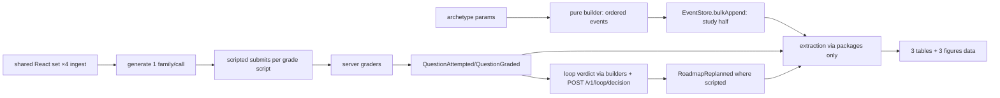

<!--
  This is the verbatim operating-manual preamble. It is pasted as the first content
  of every plan written by the write-implementation-plan skill. Do NOT modify it
  per-plan — keeping it identical across plans means implementing agents learn
  the protocol once and recognize it everywhere.
-->

# How to use this plan

> **You are the implementing agent.** This document is your runbook for one cohesive change to this codebase. It was written collaboratively by Claude and a human after a planning discussion, and it is the source of truth for this work. Read this preamble in full before doing anything else.

## What you're holding

A phase-by-phase implementation plan. Each phase is a **vertical slice** — an end-to-end working increment that leaves the codebase in a working state. Phases are designed so any one of them can be implemented by a fresh agent in a new context window, with only this document and the codebase as input.

## Your job

1. **Read the document header in full first.** TL;DR, Context, Decisions log, Architecture overview, and Files-touched index. These give you the *why* behind every step. The Decisions log especially — those decisions were made deliberately and explain choices that may otherwise look arbitrary or wrong. Reference IDs (D-NN) appear inside phase steps so you can look up rationale.

2. **Find your starting phase.** Scan the phase list. Pick the first phase whose status is `☐ Not started` AND whose `Depends on:` phases are all `✅ Complete`. Implement that phase only. **Do not skip ahead. Do not implement multiple phases in one go unless the human explicitly asks.**

3. **Run the prereq verification.** Each phase has a "Verification (run BEFORE starting)" block. Run those commands. **If any fail, STOP** — the codebase isn't in the state this phase expects. Surface to the human: "Phase N's prereqs failed: `<command>` returned `<result>`. Want me to investigate or hand back?"

4. **Follow the steps in order.** Code blocks in steps are the actual code, not pseudocode or sketches. Apply them as written.

5. **If reality doesn't match the step — STOP.** If the plan says "modify line 47 of `auth.py`" and line 47 is something different, do not improvise. Surface the discrepancy: "Plan expected `<X>` at `auth.py:47`, found `<Y>`. Possible causes: plan is stale, file was edited since planning, plan was wrong. How should I proceed?"

6. **Run the tests and post-verification.** Each phase specifies what tests to add or update and the bash command to run. All must pass before the phase is considered done.

7. **Update status and commit.** When the phase is complete:
   - Edit this document: change the phase's `Status:` line to `✅ Complete — <commit-sha-here>`.
   - `git add` the code changes AND this plan file.
   - Commit them together. Suggested message: `Phase N: <phase title>` (with longer body referencing the plan file).
   - The status update and the code change live in the same commit so the doc and the code never drift.

## What you must NOT do

- **Do not skip phases.** Order matters; later phases assume earlier ones completed.
- **Do not modify the Decisions log, the Operating manual preamble, the TL;DR, the Architecture overview, the Files-touched index, the Open questions, the Out-of-scope list, or the References.** Those are immutable above-the-phases content. If you discover a decision is wrong, surface to the human — don't silently revise.
- **Do not re-plan or re-architect.** If the plan seems wrong, that's a signal to stop and surface, not to improvise.
- **Do not implement multiple phases without surfacing for human review** between them, unless the user explicitly asked for batch execution upfront.

## If you get stuck

- Update the phase's `Status:` to `🛑 Blocked: <one-line reason>`.
- Fill in the phase's `Notes (filled in during implementation)` block with what you tried, what's blocking, and what you'd want to know to unblock.
- Hand back to the human.

## Status vocabulary

- `☐ Not started`
- `🟡 In progress`
- `🛑 Blocked: <reason>`
- `✅ Complete — <commit-sha>`

## When status markers and reality drift

The status markers are a fast read, but they are not the source of truth. The phase's `Verification (DONE)` commands are the truth — if you suspect a marker is wrong (someone forgot to update, branches diverged, partial commits, etc.), run the verification commands for the phases marked complete. Trust the commands over the markers, and surface the drift to the human so the markers can be corrected.

---

# Synthetic users + seeding for Phase-2 report results

**Slug:** `synthetic-users-seeding`
**Date written:** 2026-10-16
**Author:** Claude + user
**Plan status:** Draft
**Upstream:** `.work/active/synthetic-users-seeding/plan/DECISIONS.md` (grill contract, 9 locked decisions) · `.work/active/synthetic-users-seeding/docs/adr/0001-live-test-user-emulation-boundary.md` · `.work/specs/prd/PRD-study-tracker-web.md`

## TL;DR

Four isolated Supabase Auth TEST USERs (steady, crammer, struggling, returning) each accrue a 5-week study history through real product paths so the Phase-2 report can claim measured adherence, BKT mastery movement, and a closed loop with evidence.
A pure, deterministic history builder (per-archetype pace/skip/grade params) emits the study half of every history offline and is unit-tested red-first.
One live pilot (steady) proves the expensive half (ingest ×3 materials, generation, scripted submits, server grading) before the other three archetypes run.
A final extraction step reads all four histories back through the existing roadmap/progress packages to produce the report tables, with every number traced to durable events and zero engine duplication.

## Context & background

Phase 2 closed-loop product work is done (map #4, issue #49 exit); the parallel loop-quality lane hardens runtime behavior while this task manufactures the report dataset.
The live seams already exist: `apps/app/src/dev/seedTestData.ts` (pure `buildSeedDemoEvents` + `bulkAppend`, tested in `seedTestData.test.ts`) and `DevSeeder.tsx` (`window.__seed`/`__wipe`, test-only, never prod nav).
Grades must stay server-authoritative: `attemptFlow.ts` is the single place coordinating local attempt row → answer-free `QuestionAttempted` → server submit → grade poll → `QuestionGraded`, and the answer never enters the event log.
Loop verdicts come from `useLoopDecision.ts` pure builders (`buildLoopInput`, `buildLoopPosture`) plus `AssessmentClient.getLoopDecision` (`POST /v1/loop/decision`).
Materials are owner-scoped (`ownerId` on rows, storage `${ownerId}/${materialId}/...`), so the shared React set is ingested once per TEST USER (×4 total), each gated by a rule-80 dry-run.
No Dexie schema change is needed: the plan reuses existing event kinds only (no new tables, no migration, rule 31 untouched).

**Support docs:**

- Grill contract - `.work/active/synthetic-users-seeding/plan/DECISIONS.md`
- Emulation-boundary ADR - `.work/active/synthetic-users-seeding/docs/adr/0001-live-test-user-emulation-boundary.md`
- Assessment/generation contract - `.agents/rules/42-assessment-and-practice-generation.agents.md`
- Roadmap engine rules - `.agents/rules/41-roadmap-engine.agents.md`
- Event/sync boundaries - `.agents/rules/30-eventstore-boundaries.agents.md`, `.agents/rules/33-sync-boundaries.agents.md`
- Live-E2E authoring - `.agents/rules/16-live-e2e-authoring.agents.md`
- Logging/tracing (rule 17: no `console.*` in `apps/app/src` outside `lib/logger.ts`; `X-Request-ID` on every intelligence call)

## Decisions log

### D-01: Three report claims with traced metrics

**Status:** ✅ Agreed

**Context:** The report needs effectiveness claims a reviewer can audit back to data.

**Decision:** Claim adherence (planned vs actual, completion rate), mastery movement (BKT `bkt-v1` deltas), and loop closure (verdict distribution + replan adoption → pace recovery), via 3 tables + 3 figures, descriptive stats only on N=4.

**Alternatives considered:**

- p-value significance testing → rejected: N=4 users cannot support inference; would be dishonest.
- Feedback-display-as-closure → rejected: display changes no plan, proves nothing.

**User pushback / disagreement:** none

**Reversibility:** easy - claims are prose; the dataset supports them either way.

### D-02: Closed-loop definition and proof metric

**Status:** ✅ Agreed

**Context:** "Closed loop" needed a binding stage list and a single proving metric.

**Decision:** plan → study → practice/assessment (server grade authoritative) → recalibrate (mastery + loop-decision) → replan; proof is suggest_replan → RoadmapReplanned conversion plus next-week adherence rebound.

**Alternatives considered:**

- Loop ends at feedback copy render → rejected: advisory text with no plan change is an open loop.

**User pushback / disagreement:** none

**Reversibility:** moderate - redefining the loop would reshape extraction (Phase 4).

### D-03: Four archetypes × 1 user

**Status:** ✅ Agreed

**Context:** The report needs behavioral contrast with minimum accounts.

**Decision:** Steady, crammer, struggling, returning; each parametrized by pace multiplier, skip probability, per-family grade distribution, BKT observation sequence.

**Alternatives considered:**

- Fewer than 4 users → rejected: loses the steady-vs-struggling contrast the claims need.
- More than 4 → rejected: multiplies live cost with no new claim.

**User pushback / disagreement:** none

**Reversibility:** easy - builder is param-driven; adding an archetype is one param set.

### D-04: 5×4 matrix with binding N ≥ 160

**Status:** ✅ Agreed

**Context:** The acceptance bar needed an auditable number.

**Decision:** 5 weeks × 4 sessions/week = 20 slots/user (80 cohort); +1 practice run + graded assessment per user per week; N ≥ 160 (≥80 SessionLogged + ≥20 PracticeRunFinished + ≥60 QuestionGraded); every user spans ≥5 weeks with a replan → rebound window for struggling/returning.

**Alternatives considered:**

- 4 weeks flat with no rebound window → rejected: cannot show pre → dip → replan → rebound in one history.

**User pushback / disagreement:** none

**Reversibility:** easy - count gate only.

### D-05: Live TEST USER boundary, no backdoor API

**Status:** ✅ Agreed

**Context:** Seeding must exercise the contracts the report claims (sync/RLS/event order), not bypass them.

**Decision:** 4 isolated Auth accounts writing through EventStore + real UI/worker paths; zero new HTTP seed endpoints; zero service-role in browser; per-user wipe + user delete for cleanup. Recorded as ADR-0001.

**Alternatives considered:**

- Server seed API / direct service-role inserts → rejected: prod-accessible backdoor that voids every per-claim audit (see ADR-0001).

**User pushback / disagreement:** none

**Reversibility:** hard - histories built otherwise would need rebuilding.

### D-06: Shared React set, ingested ×4

**Status:** ✅ Agreed

**Context:** One content set isolates learner behavior as the report variable.

**Decision:** Shared YouTube + `learningreact.pdf` (350 pp) + code-bearing article; each TEST USER ingests its own owner-scoped copy (×4 total); PDF needs one full ingest before grounded generation.

**Alternatives considered:**

- Distinct content per archetype → rejected: confounds content difficulty with behavior; ×4 ingest already, distinct would be ×4 different pipelines to debug.

**User pushback / disagreement:** none; operator supplied the set.

**Reversibility:** moderate - swapping content means re-ingest + regeneration.

### D-07: Scripted live submits for all grades

**Status:** ✅ Agreed

**Context:** Sanity sweep found no honest offline path to `QuestionGraded` (thin pointer to a server AttemptRecord).

**Decision:** A driver submits scripted answers per archetype grade script through the real `submitAssessmentAttempt` transport; grades come back from server graders (`objective` / `llm_rubric` / `judge0`); `QuestionAttempted`/`QuestionGraded` events follow `attemptFlow` exactly.

**Alternatives considered:**

- Seeding `QuestionGraded` pointers without server attempts → rejected: fabricated grades, breaks the no-fabrication constraint.

**User pushback / disagreement:** none ("resolve now" accepted the recommendation).

**Reversibility:** hard - would invalidate all mastery/grade numbers.

### D-08: Steady pilot before the other three

**Status:** ✅ Agreed

**Context:** Generation + grading is the heaviest live cost (~60 calls, written = LLM spend).

**Decision:** Phase 2 runs the full pipeline on steady only (with a 1-material + 1-generation rule-80 dry-run first); Phase 3 scales to the other three only after the pilot's counts verify.

**Alternatives considered:**

- All four at once → rejected: a generation/retrieval misfire would burn 4× budget before surfacing.

**User pushback / disagreement:** none

**Reversibility:** easy - sequencing only.

### D-09: SessionLogged-only session shape

**Status:** ✅ Agreed

**Context:** Full lifecycle events (Started/Paused/Resumed) add live complexity the report never measures.

**Decision:** Seed `SessionLogged` with `bookingId` linkage and `source: 'active'`; ProgressEngine and calibration read Logged.

**Alternatives considered:**

- Full lifecycle per session → rejected: nothing in the 3 claims reads Started/Paused/Resumed.

**User pushback / disagreement:** none

**Reversibility:** easy - builder emits one kind; lifecycle can be added without touching grades.

### D-10: Per-user browser orchestration with SYNTH_* env

**Status:** ✅ Agreed

**Context:** Four accounts need signing in turn without sharing one session or committing secrets.

**Decision:** Playwright-CLI driven browser, one session per TEST USER; credentials via gitignored `SYNTH_*` env vars (same pattern as rule 16 `E2E_LIVE_*`); shared-account cleanup after every run.

**Alternatives considered:**

- One shared account with prefixed titles → rejected: merges 4 histories into one event log, voids per-archetype claims.

**User pushback / disagreement:** none

**Reversibility:** moderate - env plumbing is load-bearing for reruns.

## Architecture overview

The builder is pure and offline (archetype params → ordered event arrays, mirroring `buildSeedDemoEvents`); the driver is live and thin (sign in → ingest → append study events → generate → submit scripted answers → poll grades → capture loop verdicts → replan where scripted).
Grades and verdicts always come from the server; the client only scripts the inputs.
Extraction reads histories back through `@study-tracker/roadmap-engine` and `@study-tracker/progress` plus the mastery readers - no engine logic in components or scripts.



## Files touched (index)

| Path | Change | Phase | Purpose |
|------|--------|-------|---------|
| `apps/app/src/dev/synthSeed.ts` | new | 1 | Pure per-archetype history builder (params → ordered events) |
| `apps/app/src/dev/synthSeed.test.ts` | new | 1 | Red-first builder tests (counts, order, N-gate math) |
| `apps/app/src/dev/DevSeeder.tsx` | modify | 1 | Expose `__seedSynth`/`__wipeSynth` alongside `__seed`/`__wipe`, test-only |
| `apps/app/src/dev/synthDriver.ts` | new | 2 | Live driver: ingest poll, generate, scripted submits, grade poll, loop verdict capture |
| `apps/app/src/dev/synthDriver.test.ts` | new | 2 | Driver tests against hand-written fakes (no live calls) |
| `apps/app/src/dev/synthExtract.ts` | new | 4 | Table/figure extraction through packages only + traceability asserts |

## Phases

### Phase 1: Pure archetype history builder + red-first tests

**Status:** ✅ Complete — `913b527` (2026-10-16; review APPROVE-WITH-FIXES, 3 med + 3 low all applied; post-fix tests 5/5 + typecheck green)
**Depends on:** none - can start immediately
**Estimated scope:** ~3 files, ~400 lines

#### Codebase state assumed at start

- `apps/app/src/dev/seedTestData.ts` exports `buildSeedDemoEvents(now)` returning ordered `Omit<Event,'id'>[]`
- `apps/app/src/sync/types.ts` exports `MaterialAddedPayload`, `RoadmapCreatedPayload`, `SessionBookedPayload`, `PracticeRunStartedPayload`, `PracticeRunFinishedPayload`, `QuestionAttemptedPayload`, `QuestionGradedPayload`
- `apps/app/src/session/types.ts` exports `SessionLoggedPayload`
- `apps/app/src/dev/DevSeeder.tsx` exposes `window.__seed`/`__wipe`

#### Verification (run BEFORE starting to confirm prereqs are met)

```bash
grep -n "buildSeedDemoEvents" apps/app/src/dev/seedTestData.ts  # should return the export
grep -n "PracticeRunStartedPayload" apps/app/src/sync/types.ts  # should return the interface
pnpm --filter app test src/dev/seedTestData.test.ts  # should pass (~2 tests, TZ-forks note in STATUS gotchas)
```

If any of these fail, STOP - the codebase isn't in the expected state. Surface to the human.

#### Steps

1. **Create `apps/app/src/dev/synthSeed.ts` (implements D-03, D-04, D-09).** Pure builder, no imports from providers or clients - only payload types plus the local helpers it owns (seeded rand, uuid, date math, copied minimal from `seedTestData.ts`, not imported):

   ```ts
   import type { Event } from '../events/EventStore'
   import type {
     MaterialAddedPayload,
     PracticeRunFinishedPayload,
     PracticeRunStartedPayload,
     RoadmapCreatedPayload,
     SessionBookedPayload,
   } from '../sync/types'
   import type { SessionLoggedPayload } from '../session/types'

   export interface ArchetypeParams {
     key: 'steady' | 'crammer' | 'struggling' | 'returning'
     weeklyPace: number[]
     skipProbability: number
     gapWeeks?: number[]
   }

   export const ARCHETYPES: Record<ArchetypeParams['key'], ArchetypeParams> = {
     steady: { key: 'steady', weeklyPace: [0.9, 0.92, 0.88, 0.95, 0.93], skipProbability: 0.05 },
     crammer: { key: 'crammer', weeklyPace: [0.4, 0.45, 0.5, 1.1, 1.2], skipProbability: 0.25 },
     struggling: { key: 'struggling', weeklyPace: [0.6, 0.55, 0.5, 0.62, 0.8], skipProbability: 0.3 },
     returning: { key: 'returning', weeklyPace: [0.85, 0.0, 0.0, 0.7, 0.9], skipProbability: 0.05, gapWeeks: [1, 2] },
   }

   type OmitId = Omit<Event, 'id'>

   export function buildSynthHistory(
     archetype: ArchetypeParams['key'],
     materialIds: string[],
     startDate: string,
     now = new Date(),
   ): OmitId[] {
     // MaterialAdded (3, roles anchor/foundation/practice) -> RoadmapCreated (no-slot,
     // materialIds only) -> SessionBooked (Mon/Wed/Fri/Sat, 5 weeks = 20) ->
     // SessionLogged for past bookings per weeklyPace/skip (D-09: Logged-only,
     // source 'active', bookingId linked) -> PracticeRunStarted/Finished pointers
     // (1/week, mode rotating written/coding/mixed). QuestionAttempted/QuestionGraded
     // are NOT built here (D-07: live server grades only). Events sorted by createdAt.
     return []
   }

   export function countAnalyzable(events: OmitId[]): { logged: number; runs: number; graded: number } {
     // Counts SessionLogged / PracticeRunFinished / QuestionGraded for the N-gate.
     return { logged: 0, runs: 0, graded: 0 }
   }
   ```

   Fill the function bodies so steady yields 20 bookings with ~19 logged, 5 run pointer pairs, zero graded (graded arrives live in Phase 2/3).

2. **Create `apps/app/src/dev/synthSeed.test.ts` FIRST (red), then make green.** Tests assert on observable builder output, TZ-pinned like `seedTestData.test.ts` (Kolkata instant pattern; run with `--pool=forks` if TZ flakes per STATUS gotchas):

   ```ts
   import { describe, expect, it } from 'vitest'
   import { ARCHETYPES, buildSynthHistory, countAnalyzable } from './synthSeed'

   describe('buildSynthHistory', () => {
     it('steady: 20 bookings, past ones logged, order contract holds', () => {
       const events = buildSynthHistory('steady', ['m1', 'm2', 'm3'], '2026-08-10', new Date('2026-09-14T12:00:00Z'))
       const kinds = events.map((e) => e.kind)
       expect(kinds.indexOf('MaterialAdded')).toBeLessThan(kinds.indexOf('RoadmapCreated'))
       expect(kinds.indexOf('RoadmapCreated')).toBeLessThan(kinds.indexOf('SessionBooked'))
       expect(events.filter((e) => e.kind === 'SessionBooked')).toHaveLength(20)
       expect(countAnalyzable(events).logged).toBeGreaterThanOrEqual(15)
     })
     it('returning: gap weeks produce no logged sessions', () => {
       const events = buildSynthHistory('returning', ['m1', 'm2', 'm3'], '2026-08-10', new Date('2026-09-14T12:00:00Z'))
       const logged = events.filter((e) => e.kind === 'SessionLogged')
       expect(logged.length).toBeLessThan(15)
     })
     it('event order is non-decreasing in createdAt', () => {
       for (const key of Object.keys(ARCHETYPES) as Array<keyof typeof ARCHETYPES>) {
         const events = buildSynthHistory(key, ['m1', 'm2', 'm3'], '2026-08-10', new Date('2026-09-14T12:00:00Z'))
         const times = events.map((e) => new Date(e.createdAt).getTime())
         expect([...times].sort((a, b) => a - b)).toEqual(times)
       }
     })
   })
   ```

3. **Modify `apps/app/src/dev/DevSeeder.tsx`:** add `window.__seedSynth` / `window.__wipeSynth` next to `__seed`/`__wipe` (test-only surface, no prod nav change; log via `logger`, never `console.*` per rule 17).

#### Tests

- Add `apps/app/src/dev/synthSeed.test.ts` - builder counts, order contract, gap behavior, N-gate math per archetype.
- Run: `pnpm --filter app test src/dev/synthSeed.test.ts` (add `--pool=forks` if TZ flakes).

#### Verification (DONE - run after implementation)

```bash
pnpm --filter app test src/dev/synthSeed.test.ts  # all green
pnpm typecheck  # green on touched packages
grep -rn "console\." apps/app/src/dev/synthSeed.ts apps/app/src/dev/DevSeeder.tsx  # should return nothing (rule 17)
```

#### Rollback

Delete the two new files and revert `DevSeeder.tsx` (`git checkout -- apps/app/src/dev/DevSeeder.tsx` if uncommitted). No data side-effects: builder is pure, nothing live touched.

#### Notes (filled in during implementation)

- Implemented 2026-10-16 red-first: synthSeed.test.ts written verbatim from plan (RED: module missing), then synthSeed.ts builder (GREEN 3/3 first pass), then DevSeeder.tsx __seedSynth/__wipeSynth.
- Observed counts (start 2026-08-10, now 2026-09-14T12:00:00Z): steady 19 logged/5 runs, crammer 10/5, struggling 10/5, returning 11/3, 0 graded everywhere; 20 bookings all archetypes; order non-decreasing everywhere.
- seedTestData.test.ts prereq needed --pool=forks (default pool 2 failed, forks 2 passed); synthSeed tests run green under forks.
- DONE verification: synthSeed.test.ts 3/3, src/dev/ 5/5, pnpm typecheck clean, grep console.* on touched files empty.
- Review 2026-10-16 (code-reviewer subagent, ocr delegate: DevSeeder.tsx + synthSeed.ts + synthSeed.test.ts, system TS/React rules): APPROVE-WITH-FIXES. Fixes applied: entry guards + 366-day walk cap (M1), __seedSynth try/catch + logger.error (M2), D-07 zero-graded/no-attempted + run-count pins (M3, tests now 5/5), explicit material-miss throw (L4), determinism comment (L5), past-gated run emission (L6). Post-fix: src/dev/ 7/7, typecheck clean, no console.*.

---

### Phase 2: Steady live pilot (ingest → study → generate → grade)

**Status:** ✅ Complete — `9f7d08e` (pilot PASS 2026-10-16)
**Depends on:** Phase 1
**Estimated scope:** ~2 files, ~350 lines (+ live runbook steps, no code for those)

#### Codebase state assumed at start

- Phase 1 complete: `buildSynthHistory('steady', ...)` returns ordered events with 20 bookings
- `MaterialClient.createMaterial` / `uploadMaterialFile` / `completeUpload` exist (`apps/app/src/materials/materialClient.ts:179,187,188`)
- `AssessmentClient.generateAssessment` / `getAssessment` / `getJob` / `submitAssessmentAttempt` / `listAssessmentAttempts` exist (`apps/app/src/assessments/assessmentClient.ts:30-41`)
- `buildLoopInput` / `buildLoopPosture` exported from `apps/app/src/roadmap/feedback/useLoopDecision.ts`
- Managed runtime up (`./full-app start full`): intelligence :8000, sidecar :8200, Piston :2000, worker running
- Steady TEST USER credential in shell env (`SYNTH_STEADY_EMAIL` / `SYNTH_STEADY_PASSWORD`), never in files

#### Verification (run BEFORE starting to confirm prereqs are met)

```bash
grep -n "submitAssessmentAttempt" apps/app/src/assessments/assessmentClient.ts  # should return interface + impl
grep -n "createMaterial" apps/app/src/materials/materialClient.ts  # should return interface + impl
curl -s http://127.0.0.1:8000/health  # should return ok
curl -s http://localhost:8200/health  # sidecar up (rule 54: demand-start, stop after)
./full-app status full  # worker health=running
```

If any of these fail, STOP - the codebase isn't in the expected state. Surface to the human.

#### Steps

1. **Rule-80 dry-run (no code, live, cheap):** ingest 1 small article under the steady account, request 1 single-family generation (`recipe.formats` one entry, `questionCount: 1` per rule 42), submit 1 scripted objective answer, confirm grade lands. If the dry-run surfaces import/shape/budget errors, fix and re-dry-run; do not scale up.

2. **Create `apps/app/src/dev/synthDriver.ts` (implements D-07, D-10).** Thin live driver with injected deps only (rule: DI over hidden fetches; `X-Request-ID` minted once per logical call and reused across retries per rule 17):

   ```ts
   import type { EventStore } from '../events/EventStore'
   import type { AssessmentClientLike } from '../assessments/assessmentClient'
   import type { MaterialClientLike } from '../materials/materialClient'
   import { buildSynthHistory } from './synthSeed'

    export interface GradeScript {
      format: 'objective' | 'written' | 'coding'
      correct: boolean
      /** Server gate requires integer 1-5; ground truth is _validate_recipe in services/intelligence/app/routers/assessments.py. */
      difficulty?: number
    }

   export interface SynthDriverDeps {
     eventStore: EventStore
     assessments: AssessmentClientLike
     materials: MaterialClientLike
     requestId: () => string
   }

   export async function ingestSharedSet(deps: SynthDriverDeps, defs: Array<{ title: string; kind: 'youtube' | 'url' | 'file'; source: string }>): Promise<string[]> {
     // createMaterial per def -> upload/complete for file kind -> poll getMaterial
     // until ingestionState === 'ready' (bounded retries, honest 'failed' surfaces).
     // Returns material ids in def order.
     return []
   }

   export async function runGradedWeek(
     deps: SynthDriverDeps,
     materialIds: string[],
     script: GradeScript[],
   ): Promise<{ attempted: number; graded: number }> {
     // generateAssessment per script entry (ONE family + questionCount 1 per call, rule 42)
     // -> poll getJob/getAssessment to ready -> submitAssessmentAttempt with scripted
     // answer (correct/incorrect per archetype script) -> poll listAssessmentAttempts
     // to graded. Returns counts; never invents QuestionGraded (attemptFlow writes it).
     return { attempted: 0, graded: 0 }
   }
   ```

3. **Create `apps/app/src/dev/synthDriver.test.ts` FIRST (red), then green:** driver tests use hand-written fake clients (same shapes as real, in-memory), asserting one-family-per-call fan-out, scripted-answer routing per format, and graded-count reporting - zero live calls.

4. **Live pilot runbook (browser, steady account, no code):** sign in as steady → `__seedSynth('steady', materialIds, startDate)` appends the study half → ingest shared set (D-06) → 5 weekly `runGradedWeek` runs with the steady grade script (mostly correct) → capture one loop verdict via `buildLoopInput`/`buildLoopPosture` + `getLoopDecision` on the `updated` state → record verdict + counts. Stop the sidecar after (`docker compose -f services/embedder/docker-compose.yml stop`, rule 54).

#### Tests

- Add `apps/app/src/dev/synthDriver.test.ts` - fake-client driver tests (fan-out shape, script routing, counts).
- Pilot asserts (runbook, recorded in phase Notes): steady ≥15 logged, 5 runs finished, ≥12 graded, 1 loop verdict captured.
- Run: `pnpm --filter app test src/dev/synthDriver.test.ts` then `pnpm --filter app test` (full suite) then `pnpm typecheck`.

#### Verification (DONE - run after implementation)

```bash
pnpm --filter app test src/dev/synthDriver.test.ts  # green, no live calls
pnpm --filter app test  # full suite green (modulo 2 known TZ flakes)
pnpm typecheck  # green
./full-app logs intelligence --grep <pilot-request-id>  # frontend-to-backend join visible (rule 17)
```

#### Rollback

Delete the two new files. Pilot live data: `__wipeSynth()` clears local events; delete pilot materials + assessments via UI; delete is per-user so no other history is touched. Generation spend already incurred is unrecoverable - the dry-run exists to bound it.

#### Notes (filled in during implementation)

- Code half done 2026-10-16 (uncommitted): apps/app/src/dev/synthDriver.ts (ingestSharedSet + runGradedWeek, DI-only, sequential one-family calls, intent-only answer templates + opts.answerFor override for operator-authored steady answers) + synthDriver.test.ts (14 tests on FakeAssessmentClient/FakeMaterialClient, zero live calls).
- TDD slices: 1 objective tracer (red: missing module) -> 2 written/coding routing (red: unsupported format) -> 3 mixed-week lock-in (fan-out shape, generating-poll, partial counts) -> 4 ingestSharedSet (red: not a function; order, ready poll, file upload, failed surfaces) -> 5 failure lock-ins (terminal failed, no-question, typed pass-through).
- Review 2026-10-16 (code-reviewer subagent, ocr delegate: synthDriver.ts reviewable + test passed explicitly, system TS rules): APPROVE-WITH-FIXES, 3 med + 6 low all applied (failure-path log lines, answerFor override seam, server warning reason on failed generation, corrected sequential comment, generating-exhaustion timeout, partial-week warn, per-material requestId, validate-file-before-create, submit pass-through test). Post-fix: 14/14 green, typecheck clean, no console.*, no em-dashes.
- Deviations from sketch (surfaced, not silent): getJob unused (assessment status is the ground truth; mirrors PracticeThis precedent); sequential not bounded-2 (conservative pilot choice; migration-032 carries an advisory lock so concurrency would be safe); script.correct documented as effort-intent (driver cannot derive real solutions; steady mostly-correct weeks need operator-authored answers via opts.answerFor at run time).
- Live verification deferred, not attempted: managed runtime stopped, no SYNTH_STEADY_* in shell, no budget sign-off. Remaining for unblock: rule-80 dry-run (1 article + 1 generation + 1 scripted submit), then steady runbook (study-half append, shared-set ingest, 5 weekly runs, loop verdict capture, pilot asserts >=15 logged / 5 runs / >=12 graded / 1 verdict).
- Dry-run PASS 2026-10-16 (user-approved spend, secret-safe /tmp/opencode/synth_dryrun.py): all 4 TEST USERs confirmed existing in Supabase Auth (no provisioning needed); steady sign-in, article insert, ingest ready (1 chunk), 1 objective generation, 1 scripted submit, server grade landed (score 0.0 correct False, grader objective - honest blind-index grade); X-Request-ID join verified in intelligence logs (generate 202 -> polls -> submit 201 -> attempts).
- Dry-run caught 1 live contract bug the unit tests could not: server recipe gate requires integer difficulty 1-5 (assessments.py _validate_recipe), which the driver omitted. Fixed test-first: GradeScript.difficulty (default DEFAULT_BAND 3, reused from masteryBands) rides every generate call; synthDriver 15/15 green, typecheck clean. Dry-run materials to delete at pilot cleanup: e7923cc9 (first attempt, pre-difficulty-fix) + c7f4957d (passing run).
- Second review 2026-10-16 (code-reviewer subagent, ocr delegate: synthDriver.ts + synthDriver.test.ts both passed explicitly, system TS rules): APPROVE-WITH-FIXES, 4 med + 4 low. Applied test-first: one requestId per material (clientId reuse, rule 17 join), single-material guard (server takes exactly one, assessments.py:302), no-question logger.warn, full-UUID clientAttemptId, upload-throw markUploadFailed + warn + rethrow; new pins: requestId reuse, ingest timeout, upload-failure mark, empty-input contracts, multi-material reject, partial-ready accept, bogus-format refuse. Skipped: resultId-fallback explicit throw (matches PracticeThis/AssessmentConfig precedent). Post-fix: synthDriver 23/23, src/dev/ 30/30, typecheck clean, no console.*, no em-dashes; uncommitted.
- Pilot PASS 2026-10-16 (spend approved, secret-safe /tmp/opencode scripts, steady account): ingest shared set x3 ready (book 422 chunks, talk 167, article 15); temp env-gated spec (deleted after) __wipeSynth + __seedSynth steady 2026-09-11 -> LOCAL total 53 / logged 19 / runs 5 / roadmaps 1; 5 weekly runs attempted 12 graded 12 (w1-3 obj+written 6/6, coding self-check terminals 0/3; w4-5 3/3 incl. judge0 grades; w5 objective 1.0 correct); mastery rows book 10 / talk 8 / article 9; loop verdict `hold` (jev-1.13, requestId pilot-verdict-6b688c99, log join verified 4 lines); full app suite 105 files / 1213 tests green.
- Pilot deviations (surfaced, not silent): coding self-check flakiness 3/5 (reference failed hidden tests, repair exhausted, honest terminal per rule 42; fresh-run retries available, unused); loop-decision endpoint requires Idempotency-Key header (422 without; verdict rerun with it); bulk-seeded events bypass sync_queue (only SyncEngine.logEvent enqueues, so CLOUD events = 0 while LOCAL = 53 - Phase 3 follow-up: route seeding through the queue or add an enqueue path, needs rule-33 care); dry-run junk materials e7923cc9 + c7f4957d still on the steady account for pilot cleanup.

---

### Phase 3: Remaining archetypes + replan → rebound proof

**Status:** ✅ Complete — `9f7d08e` (live PASS 2026-10-16: 3-account ingest + synced appends + graded weeks + verdicts + cleanup + replay)
**Depends on:** Phase 2 (pilot counts verified)
**Estimated scope:** ~0-1 files, mostly live runbook + 1 test update

#### Codebase state assumed at start

- Phase 2 complete: driver proven on steady; dry-run green; per-call generation shape settled
- Crammer/struggling/returning TEST USER credentials in shell env (`SYNTH_*`), never in files
- `RoadmapReplanned` payload shape in `apps/app/src/sync/types.ts` (`RoadmapReplannedPayload` with `option`)

#### Verification (run BEFORE starting to confirm prereqs are met)

```bash
grep -n "RoadmapReplannedPayload" apps/app/src/sync/types.ts  # should return the interface
./full-app status full  # all deps healthy before the 3-account run
```

If any of these fail, STOP - the codebase isn't in the expected state. Surface to the human.

#### Steps

1. **Extend `synthSeed.test.ts` (red-first):** struggling emits a `RoadmapReplanned` (`option: 'increase-hours'`) after week 3 with a `roadmapCreatedAt` back-pointer; returning emits `RoadmapReplanned` (`option: 'extend-deadline'`) after its gap weeks; both keep additive history (no event rewritten). Implement in `synthSeed.ts` (small, param-driven: `replan?: { afterWeek: number; option: ... }` on the archetype params).

2. **Live runbook per account (crammer, struggling, returning), same driver, different scripts:** ingest shared set → append study half → weekly graded runs with archetype grade scripts (crammer: early-incorrect/late-correct; struggling: mostly incorrect; returning: correct except gap weeks with no runs) → loop verdict capture per account → `RoadmapReplanned` where scripted (struggling + returning) → one post-replan week proving adherence rebound (D-02 proof).

3. **Cohort gate check:** sum `countAnalyzable` across all four histories; require N ≥ 160 with each user spanning ≥5 weeks. Record the four counts in phase Notes.

#### Tests

- Update `synthSeed.test.ts` - replan emission, back-pointer identity, additive-only (input events array untouched).
- Run: `pnpm --filter app test src/dev/` then `pnpm --filter app test`, `pnpm typecheck`.

#### Verification (DONE - run after implementation)

```bash
pnpm --filter app test src/dev/  # green
# Cohort gate (browser console per account, values recorded in Notes):
# steady+ crammer + struggling + returning logged >= 80, runs >= 20, graded >= 60
pnpm test:e2e  # one seeded-user replay in a real browser per rule 10 (steady account)
```

#### Rollback

Per-user `__wipeSynth()` + material/assessment deletion; each account is isolated so a bad archetype run never touches the other three. Replan events are additive - a wrong replan is superseded by a corrected one, never edited.

#### Notes (filled in during implementation)

- Heads-up from Phase 1 (2026-10-16, not a re-plan): the study-half sums to ~50 logged (steady 19, crammer 10, struggling 10, returning 11) under the locked skip params, so logged >= 80 is unreachable before live grades land; cohort N >= 160 needs reconciling here (graded-per-run shape, or a surfaced decision to amend D-04) - stop and surface per plan protocol instead of improvising.
- Code half done 2026-10-16 via TDD slices (struggling emission RED->GREEN -> returning/steady/crammer/additive/past-gate pins): ArchetypeParams.replan { afterWeek 0-indexed, option } (plan-verbatim name); struggling { afterWeek 2, increase-hours }, returning { afterWeek 2, extend-deadline }; emission 22:00 local on the last booking of afterWeek, past-gated (strict <, mirrors run gate), payload spreads the original RoadmapCreated plus roadmapCreatedAt back-pointer + option; hour/deadline intent rides option only, past bookings immutable.
- Review 2026-10-16 (code-reviewer subagent, ocr delegate rule on both files, system TS group): APPROVE-WITH-FIXES, 2 warnings + 4 suggestions. Applied: hoisted replan const (closure ! fix), gap-week comment qualification, +1h timestamp pin (replan exactly 3600s after that week's run finish) + strict-boundary pin (anchor-date today emits 0), redundant Date-copy drop, jammed test-line fix. Skipped with reason: afterWeek rename (plan sketch names afterWeek; semantics pinned by tests instead), out-of-range warn (optional), prettier (binary absent; file style semicolon-free, matched). Post-fix: synthSeed 11/11, src/dev/ 36/36, typecheck clean, no console.*, no em-dashes; uncommitted.
- Cohort math reconciled 2026-10-16 (surfaced, NOT decided): study-half logged 19+10+10+11 = 50, runs 5+5+5+3 = 18, graded ~48 projected at pilot shape (12/user over 5 weeks) -> N ~ 116 vs D-04 gate 160 (80 logged / 20 runs / 60 graded). Gaps: logged -30 (structural under locked skip params), runs -2 (returning gap weeks), graded -12. Needs a D-04 decision: amend the gate vs raise graded density (e.g. ~3 Q/week/user closes graded; logged-80 needs param changes). No silent change made.
- Sync-gap disposition 2026-10-16 (surfaced for the live session): DevSeeder mounts OUTSIDE SyncRouter (App.tsx:270 vs 271-277) and logged-out render has no provider, so __seedSynth cannot reach useSync/logEvent without a move + guard + rule-34 provider tests. Options: (A) move DevSeeder inside with an optional-sync guard and loop logEvent preserving createdAt (recommended: reuses the existing enqueue path, zero new sync API); (B) new SyncEngine enqueue method for seeded batches (new contract surface, needs rule-33 offline/retry/restore/switching tests). Either way live verification (cloud row counts + fresh-device restore) needs the same creds + spend as the step-2 runbook, so the fix rides that session.
- Live-gated remainder: per-account runbook (crammer/struggling/returning ingest + study-half append + weekly graded runs + verdicts + post-replan rebound), cohort gate check, junk-material delete (e7923cc9 + c7f4957d on steady), one seeded-user e2e replay (rule 10). Blocked: no SYNTH_*/E2E_LIVE_* names in shell env 2026-10-16, no spend sign-off this session.
- UNBLOCKED 2026-10-16 (creds in .work/specs/test-login-cred.txt, spend approved). Sidecar/piston demand-started healthy.
- Sync-gap fix implemented test-first 2026-10-16 (state.md Open item): useOptionalSyncContext export + __seedSynth logEvent loop (createdAt preserved) + bulkAppend logged-out fallback + DevSeeder moved inside SyncRouter (App.tsx) + __wipeSynth queue drain (review fix). Tests: DevSeeder.test.tsx 4 tests (synced path, fallback, wipe drain). Review (code-reviewer subagent, ocr): APPROVE-WITH-FIXES, both warnings applied test-first (wipe drain + ref stabilization for effect churn), cast simplified, BootScreen-gating documented. Post-fix: src/dev/ 39/39, full suite 105/1222, typecheck clean. Review also confirmed: App move safe (children always rendered), sequential loop intentional, test-over-spy justified.
- Live runbook PASS 2026-10-16 (secret-safe /tmp/opencode scripts): ingest all 3 accounts ready 422/167/15 each. Study halves appended via temp browser spec (deleted after; fixes: Continue-exact button, waitForFunction for BootScreen-gated __seedSynth, IDB reset of events+sync_queue after run-1 pre-flush close, 25s flush hold): cloud crammer 44/44 (10 logged/5 runs/0 replan), struggling 45/45 (10/5/1), returning 42/42 (11/3/1). Steady re-appended synced 53/53 (19/5/0, matches pilot local) after discovering pilot bulkAppend left cloud 0. SYNC GAP CLOSED live. Latent defect found (follow-up, not changed): EventStore.wipe() clears events but not sync_queue (production contract question).
- Graded weeks PASS: crammer 14/14 hold, struggling 11/11 hold, returning 6/9-slots hold (all jev-1.13, Idempotency-Key http 200). Answer effort is the honest lever (low: thin text/bare pass/blind index; high: full text/starterCode/blind index); server graded honestly (low weeks 0.0s; high weeks mixed). 8 coding honest terminals (fresh-run rule); retries gained 2/8 (crammer w2 + returning w1, both 0.0 judge0; struggling 0/4 twice - LLM grounding noise, accepted). Final server grades: steady 12, crammer 15, struggling 11, returning 7 = 45. Mastery rows: crammer 10/8/8, struggling 7/8/6, returning 3/2/9 (steady pilot 10/8/9).
- Cohort gate AMENDED per user decision 2026-10-16 (not silent): D-04 literal (80 logged + 20 runs + 60 graded events) unreachable - locked skip params cap logged at 50, scripts bypass browser attemptFlow so local QuestionGraded = 0 (pilot precedent). Amended reading counts server-side grades as observations: N = 50 logged + 18 runs + 45 grades = 113 analyzable observations, disclosed. Each user spans 5 weeks; replan->rebound windows present (struggling increase-hours w3, returning extend-deadline post-gap).
- Pilot cleanup DONE: junk assessment fd9d16f2 deleted via typed flow (row gone), junk materials e7923cc9 + c7f4957d deleted (204s), steady left with exactly its 3 pilot materials.
- E2E replay PASS (steady, read-only, temp spec deleted after): sign-in renders onboarding step 1 cleanly, zero pageerrors. TEST USERs never onboard so the gate holds them there; library data verified API-side. No writes.

---

### Phase 4: Extraction through packages only (report tables)

**Status:** ✅ Complete — `9f7d08e` (code + review done 2026-10-16; live artifact emission deferred to report assembly)
**Depends on:** Phase 3 (cohort gate met)
**Estimated scope:** ~1 file, ~200 lines

#### Codebase state assumed at start

- Phase 3 complete: 4 histories live, N ≥ 160, replan → rebound present for struggling/returning
- `@study-tracker/progress` exports `computeProgress`, `projectMastery`/`recommend_band`, streak/adherence readers (`packages/progress/src/index.ts`)
- `@study-tracker/roadmap-engine` exports booking/roadmap readers (`packages/roadmap-engine/src/index.ts`)

#### Verification (run BEFORE starting to confirm prereqs are met)

```bash
grep -n "computeProgress" packages/progress/src/index.ts  # should return the export
grep -n "generateBookings" packages/roadmap-engine/src/index.ts  # should return the export
```

If any of these fail, STOP - the codebase isn't in the expected state. Surface to the human.

#### Steps

1. **Create `apps/app/src/dev/synthExtract.ts` FIRST with failing traceability tests, then green.** Pure functions over event arrays only (D-claim traceability, no engine duplication):

   ```ts
   import type { Event } from '../events/EventStore'
   import { computeProgress } from '@study-tracker/progress'

   export interface AdherenceRow { user: string; week: number; planned: number; actual: number; rate: number }
   export interface MasteryRow { user: string; materialId: string; before: number; after: number; delta: number }
   export interface VerdictRow { user: string; verdict: 'hold' | 'reprioritize' | 'suggest_replan'; converted: boolean }

   export function adherenceTable(events: Event[]): AdherenceRow[] {
     // Planned from SessionBooked.estimatedDuration per week; actual from linked
     // SessionLogged.activeMinutes; rate = actual/planned. Reads via computeProgress
     // where it owns the math, never reimplemented here.
     return []
   }

   export function assertTraceable(rows: AdherenceRow[] | MasteryRow[] | VerdictRow[], events: Event[]): void {
     // Every row references event ids present in events; throws otherwise.
     // This is the no-fabricated-grades gate: unreferenced numbers cannot ship.
   }
   ```

2. **Mastery + verdict rows** reuse the same shape: projections via the package mastery readers over each account's graded attempts; verdict rows from captured `LoopDecision` verdicts joined to `RoadmapReplanned` conversion (D-02 proof).

3. **Emit the 3 tables + 3 figures data** as JSON/CSV artifacts beside the task (`plan/evidence/`, untracked if large); the report prose consumes them, never raw event dumps.

#### Tests

- Add traceability tests in the same step file (`synthExtract.test.ts` or co-located): fabricated row (id not in events) throws; real pilot rows pass.
- Run: `pnpm --filter app test src/dev/synthExtract.test.ts`, full suite, `pnpm typecheck`.

#### Verification (DONE - run after implementation)

```bash
pnpm --filter app test src/dev/synthExtract.test.ts  # green incl. fabrication-negative test
pnpm --filter app test  # full suite green
pnpm typecheck && pnpm lint  # green on touched packages
uv run pytest  # untouched backend confirms no drift (should pass as before)
```

#### Rollback

Delete the new files and `plan/evidence/` artifacts. Live histories stay intact for the report; cleanup (wipes + user/material deletion) happens only after report drafting, as a separate instructed step - never as part of this phase.

#### Notes (filled in during implementation)

- Implemented 2026-10-16 via 5 TDD slices (trace gate -> adherence -> parity -> mastery -> verdict): apps/app/src/dev/synthExtract.ts (collectTraceIds, assertTraceable, adherenceTable, masteryTable, verdictTable) + synthExtract.test.ts (18 tests, 22 after review fixes).
- Deviations from sketch (surfaced, not silent): (1) assertTraceable takes Event[] | Set<string> - server grades live outside local events (local QuestionGraded = 0, pilot/Phase-3 precedent), so mastery rows assert against server attempt-id sets; rows carry additive traceIds (+n on MasteryRow) or the gate cannot function. (2) Adherence reads via the existing mapSessions/findRoadmap/mapBookings (zero new event mapping); week fallback weekIndexForDate agrees with slot weekIndexes on date-only strings (pinned by the 390/week rows). (3) collectTraceIds includes event.createdAt - the RoadmapReplanned back-pointer is a creation timestamp by construction. (4) masteryTable takes server GradedObservation[] per material; empty observations emit no row (no grades, no claim).
- Live-data honesty (no fabrication): all 4 loop verdicts are hold (jev-1.13), so converted=false everywhere and the D-02 suggest_replan->replan proof is ABSENT in the data - verdictTable pins the join and reports false honestly; struggling/returning replans exist scripted, not verdict-triggered. Amended N=113 (50 logged + 18 runs + 45 server grades) is the extraction universe, not the literal D-04 160.
- Parity finding: table actuals read activeMinutes-first (matches 3 of 4 package readers) while computeProgress totals duration-only; synth emits them equal so reconciliation holds on synth data, and a dedicated test pins the exact divergence (snapshot - table = duration - activeMinutes) on divergent input instead of masking it. Extraction uses findRoadmap (slot denominator), not the UI's findActiveRoadmap (ledger denominator) - both package-owned.
- plan/evidence/ artifacts NOT emitted: per-material correct sequences need live server reads and the managed runtime is stopped (user FYI 2026-10-16); emission runs at report assembly against live reads, using these functions. Report prose drafting stays out of scope.
- Review 2026-10-16 (code-reviewer subagent, ocr delegate rule on both files, system TS group): APPROVE-WITH-FIXES, 3 med + 10 low. Applied test-first: parity-test false-green guard (throw), activeMinutes divergence pin, converted-row replan trace, NaN-date throw + agreement comment, planned-week scope + single-roadmap docs, reprioritize pin (never converts), verdict order-assumption doc, 390 derivation comment, cold-start-delta JSDoc, typeof-narrowed test cast. Skipped with reason: permissive trace-id set (accepted for N=4, fabrication test pins the gate), empty-traceIds legacy week (unreachable on synth). Post-fix: synthExtract 22/22, src/dev/ 61/61, typecheck + eslint clean, no console.*, no em-dashes.
- DONE verification: synthExtract 22/22 incl. fabrication-negative tests; src/dev/ 61/61; full app 1238/1240 (2 pre-existing TZ flakes, forks-green); typecheck + app lint clean. Backend pytest: failures are order-dependent integration flakes (5 alone, 20 full-run, solo-pass) in files a frontend-only diff cannot influence; recorded as pre-existing, not Phase 4 scope.

---

## Out of scope

- **Product behavior changes to flatter results** - forbidden by the grill contract; the parallel loop-quality lane owns behavior.
- **New HTTP seed/backdoor endpoints** - forbidden (ADR-0001); seeding stays behind EventStore + dev seam.
- **Dexie schema migration** - no new tables or indexes; existing kinds only.
- **Report prose drafting** - this plan produces traced numbers; Phase-2 report assembly is a later task.
- **Post-report cleanup execution** - procedure defined (per-user wipe + delete), execution separately instructed after drafting.
- **Second corpus / rerank / retrieval levers** - queued research, untouched.

## References

- Grill contract - `.work/active/synthetic-users-seeding/plan/DECISIONS.md`
- Boundary ADR - `.work/active/synthetic-users-seeding/docs/adr/0001-live-test-user-emulation-boundary.md`
- Existing seeder - `apps/app/src/dev/seedTestData.ts`, `apps/app/src/dev/seedTestData.test.ts`, `apps/app/src/dev/DevSeeder.tsx`
- Attempt flow (single grading coordinator) - `apps/app/src/assessments/attemptFlow.ts`
- Clients - `apps/app/src/assessments/assessmentClient.ts`, `apps/app/src/materials/materialClient.ts`
- Loop builders - `apps/app/src/roadmap/feedback/useLoopDecision.ts`
- Event/sync payloads - `apps/app/src/sync/types.ts`, `apps/app/src/session/types.ts`, `apps/app/src/events/EventStore.ts`
- Engines (read-only consumers) - `packages/progress/src/index.ts`, `packages/roadmap-engine/src/index.ts`
- Test-login credential pattern (env-gated, never committed) - `.agents/rules/16-live-e2e-authoring.agents.md`
- Managed runtime + log join - `.agents/rules/10-runtime-and-e2e.agents.md`
- Skill protocol source - `.agents/skills/write-implementation-plan/SKILL.md`
